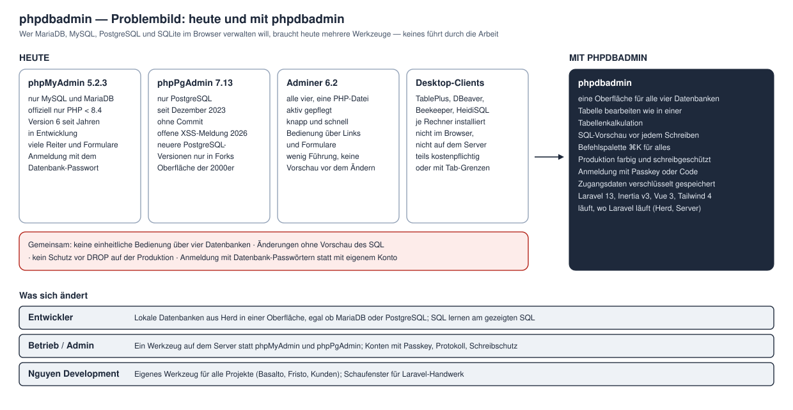
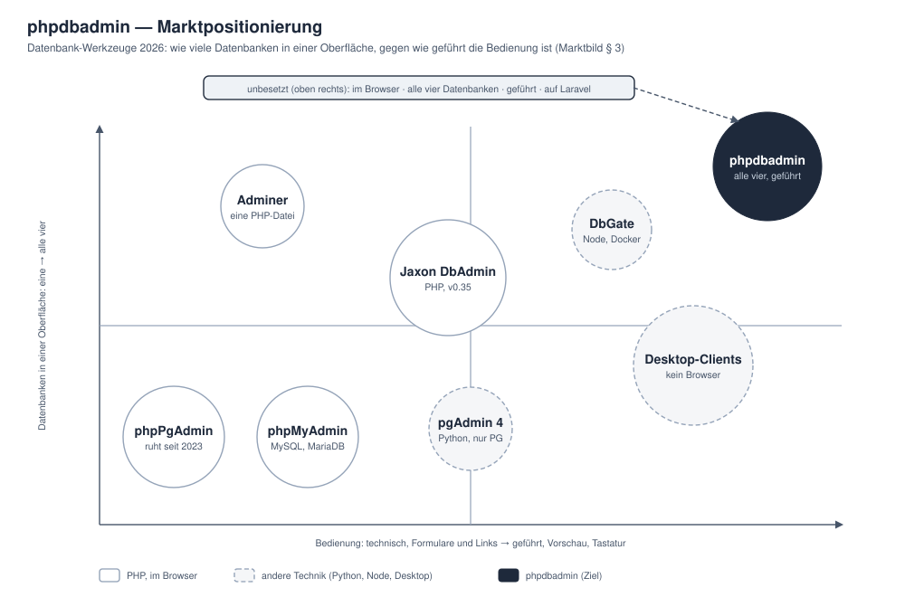
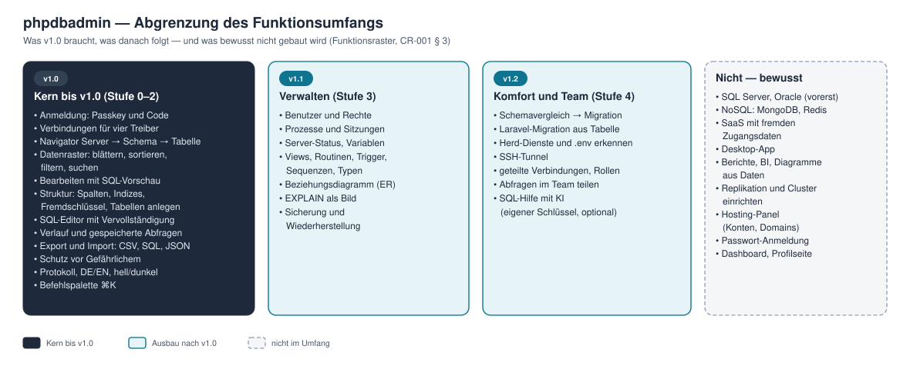
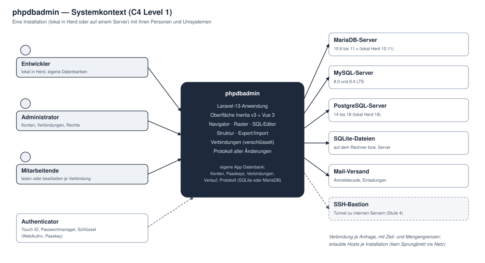
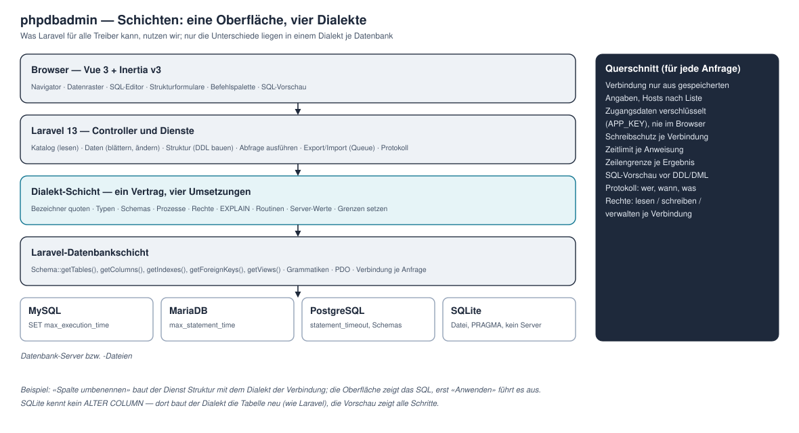
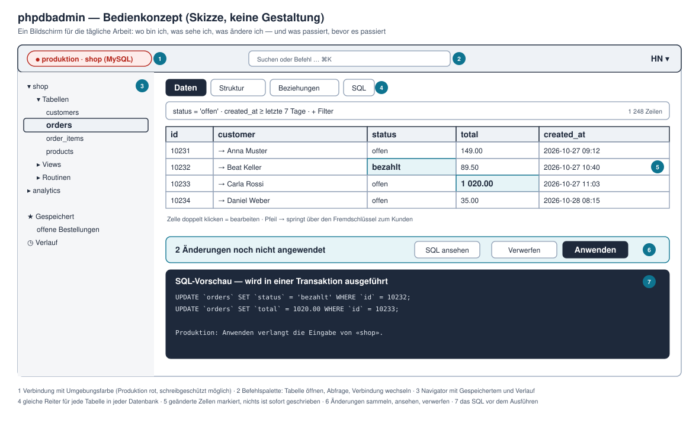
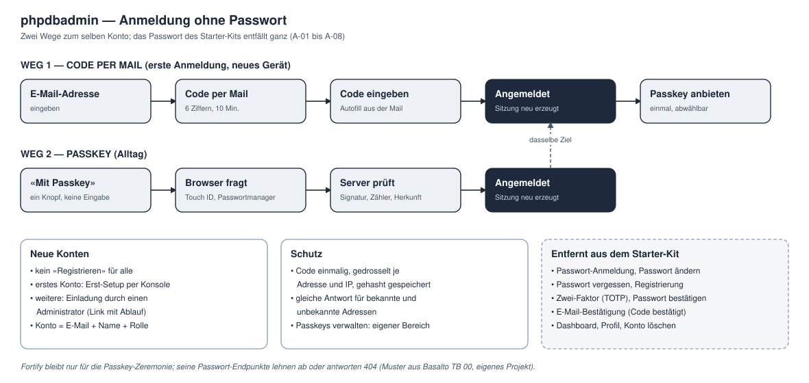
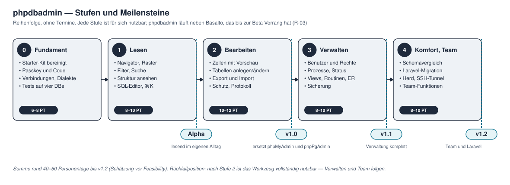

# CR-001 — phpdbadmin: Datenbank-Verwaltung im Browser für MariaDB, MySQL, PostgreSQL und SQLite

| Feld | Wert |
|---|---|
| Nummer | CR-001 |
| Titel | phpdbadmin — ein Werkzeug für vier Datenbanken, intuitiver als phpMyAdmin und phpPgAdmin |
| Antragsteller | Hoang Nguyen |
| Datum | 28.10.2026 |
| Fassung | 4 |
| Status | ✅ **Weiterführen** entschieden 28.10.2026 (Hoang: «Feasibility starten») · Feasibility abgeschlossen 28.10.2026: 6 bestanden, 4 bedingt — Auflagen als V-10, Q-09, E-06 und geänderte Abnahmen eingearbeitet |
| Grundlagen | [Ideensammlung](ideensammlung.md) · [Marktbild](marktbild.md) · [Funktionsraster](funktionsraster.md) · [Ausgangslage und Rückfragen](../01-pre-project/ausgangslage-und-rueckfragen.md) · [Ideen-Backlog](../01-pre-project/ideen-backlog.md) |
| Folgt | [Terms of Reference](../01-pre-project/terms-of-reference.md) (Entwurf v0.1) → Feasibility |

### Änderungsverlauf

| Fassung | Datum | Änderung |
|---|---|---|
| 1 | 28.10.2026 | Erste Fassung aus Hoangs Auftrag, Recherche und Funktionsraster; Anforderungen A, V, O, D, S, Q, E, W, B, N mit Abnahme |
| 2 | 28.10.2026 | Interaktive Rückfragen: R-01 und R-40 (Nguyen Development, MIT), R-11 (lokal und selbst gehostet), R-03 (neben Basalto), R-04 (Name phpdbadmin endgültig) — § 6, § 10, § 11, § 14 nachgeführt |
| 3 | 28.10.2026 | Entscheid Weiterführen; Ergebnisse der [Feasibility](../02-feasibility/feasibility.md): neu V-10, Q-09, E-06; Abnahmen von V-02, V-04, O-01, D-04, S-02, S-03, Q-02, Q-03, E-01, B-04, N-02, N-03 geschärft; Schätzung 42–53 PT |
| 4 | 28.10.2026 | Review der Foundation (Hoang): neu **V-11** Schreibschutz auf Zeit aufheben; D-04 zählt die Folgen über `ON DELETE CASCADE` in der Vorschau (aus den Wireframes) |

## 1. Ausgangslage und Problem

### 1.1 Woher die Idee kommt

Hoang arbeitet täglich mit vier Datenbanken: MariaDB und PostgreSQL lokal in Herd, SQLite in Tests und kleinen Installationen, MySQL bei Kunden und in den Pipelines von Basalto. Die Werkzeuge dafür sind getrennt, alt oder nicht im Browser. Der Auftrag vom 28.10.2026: ein Admin-Werkzeug wie phpMyAdmin oder phpPgAdmin, aber intuitiver, benutzerfreundlicher und für alle vier Plattformen — auf Laravel, ohne Passwort, ohne Dashboard und ohne Profilseite des Starter-Kits.

### 1.2 Das Problem

Ein Werkzeug je Datenbank, Bedienung über Formulare und Links, Änderungen ohne Vorschau und ohne Rückweg, Anmeldung mit Datenbank-Passwörtern, und die PHP-Klassiker stehen technisch still ([Ideensammlung § 2](ideensammlung.md#2-warum--problem-und-lücke)).

### 1.3 Marktlage

phpMyAdmin 5.2.3 ist offiziell nicht für PHP 8.4 und neuer freigegeben, phpPgAdmin ruht seit 2023, Adminer ist breit, aber knapp; die modernen Oberflächen (DbGate, CloudBeaver, Desktop-Clients) sind nicht PHP. Jaxon DbAdmin zielt seit Oktober 2026 in dieselbe Lücke und steht bei Version 0.35 ([Marktbild § 2](marktbild.md#2-was-der-markt-zeigt)).

## 2. Ziel und Positionierung

**Ziel:** Ein Werkzeug im Browser, mit dem man MariaDB, MySQL, PostgreSQL und SQLite mit **derselben Bedienung** ansieht, bearbeitet, strukturiert und austauscht — **geführt**, **sicher** und **schnell**, lokal in Herd wie auf einem Server.

**Positionierung (Vorschlag, [Marktbild § 3](marktbild.md#3-positionierung)):** «Ein Werkzeug für alle vier, das führt» mit «Sicher im Team» im Kern und «Für Laravel-Entwickler» als Unterscheidungsmerkmal nach v1.0. Leitsatz-Entwurf: *Alle vier Datenbanken. Eine Oberfläche. Nichts passiert ungesehen.*

## 3. Scope

### 3.1 Abgrenzung

v1.0 umfasst Anmelden, Verbinden, Lesen, Bearbeiten und Austauschen (Stufen 0–2); v1.1 die Server-Verwaltung (Stufe 3); v1.2 Komfort und Team (Stufe 4). Die Einordnung jeder einzelnen Funktion steht im [Funktionsraster](funktionsraster.md).

### 3.2 Architektur

phpdbadmin ist eine Laravel-13-Anwendung mit eigener App-Datenbank (Konten, Passkeys, Verbindungen, Verlauf, Protokoll). Die verwalteten Datenbanken sind Umsysteme: Die Anwendung verbindet sich je Anfrage mit den gespeicherten Angaben, unter Zeit- und Mengengrenzen und nur zu erlaubten Hosts. Mail dient nur für Anmeldecodes und Einladungen.

Was Laravel für alle Treiber kann (Verbindungen zur Laufzeit, Introspektion, DDL mit Vorschau), wird genutzt; nur die Unterschiede liegen in einer **Dialekt-Schicht** mit einem gemeinsamen Vertrag. Querschnittsregeln (Schreibschutz, Grenzen, Vorschau, Protokoll, Rechte) gelten für jede Anfrage hinter den Controllern, nicht in jedem Controller einzeln.

### 3.3 Bedienkonzept

Ein Arbeitsbildschirm für alles: Verbindung mit Umgebungsfarbe oben, Befehlspalette, Navigator links, Reiter Daten · Struktur · Beziehungen · SQL, Raster mit markierten Änderungen, Änderungsleiste und SQL-Vorschau. Die Prinzipien P-01 bis P-11 stehen in der [Ideensammlung § 6](ideensammlung.md#6-wie--produktprinzipien-vorschlag); die Gestaltung (Marke, Farben, Schrift) folgt in der Foundation.

### 3.4 Nicht im Umfang

SQL Server und Oracle (vorerst) · NoSQL (MongoDB, Redis) · SaaS mit fremden Zugangsdaten · Desktop-App · Berichte und BI · Replikation und Cluster einrichten · Hosting-Panel · Passwort-Anmeldung · Dashboard · Profilseite.

## 4. Anforderungen

Priorität nach MoSCoW: **M** Must · **S** Should · **C** Could · **W** Won't (diesmal). Stufe nach [§ 9](#9-aufwand-und-stufen). Die Abnahme ist so formuliert, dass ein Test oder ein Durchlauf sie belegen kann. Die Verteilung auf Timeboxes mit Must-Anteil unter 60 % je Stufe folgt in der PRL (Foundation).

### 4.1 A — Anmeldung und Zugang

| Nr. | Anforderung | Prio | Stufe | Abnahme |
|---|---|---|---|---|
| A-01 | **Passwort entfernt:** Anmeldung mit Passwort, Registrierung, Passwort vergessen, zurücksetzen, ändern und bestätigen, Zwei-Faktor (TOTP) und E-Mail-Bestätigung des Starter-Kits sind entfernt | M | 0 | Routenliste ohne diese Routen bzw. Fortify-Endpunkte lehnen ab; Test ruft jede alte Adresse auf (404/405); Spalten `password`, `two_factor_*` entfernt oder ungenutzt |
| A-02 | **Anmeldung mit Code per Mail:** sechs Ziffern, zehn Minuten gültig, einmalig, gehasht gespeichert, gedrosselt je Adresse und IP; gleiche Antwort für bekannte und unbekannte Adressen; Sitzung wird neu erzeugt | M | 0 | Tests für Erfolg, Ablauf, Wiederverwendung, falschen Code, Drosselung (benannter Limiter), unbekannte Adresse; Sitzungs-ID vor/nach mit Cookie geprüft |
| A-03 | **Anmeldung mit Passkey** und Passkeys verwalten (hinzufügen, umbenennen, entfernen) im Bereich **Sicherheit** | M | 0 | Zeremonie mit virtuellem Authenticator im Test; einmal von Hand mit Touch ID (Hoang) |
| A-04 | **Dashboard entfernt:** nach der Anmeldung erscheint die Verbindungsübersicht | M | 0 | `/dashboard` 404; Anmeldung leitet auf die Übersicht |
| A-05 | **Profilseite entfernt:** kein Bearbeiten von Name und E-Mail durch die Person selbst, kein «Konto löschen»; das Kontomenü zeigt Sicherheit (Passkeys, Sitzungen), Darstellung (hell/dunkel, Sprache) und Abmelden | M | 0 | `/settings/profile` 404; Menü im Durchlauf |
| A-06 | **Keine offene Registrierung:** erstes Konto per Konsole (`php artisan …`), weitere per Einladung mit Ablauf durch einen Administrator | M | 0 | Test: Einladung annehmen, abgelaufene ablehnen; Befehl legt genau ein Administratorkonto an |
| A-07 | **Rollen und Rechte:** Administrator; Mitglied mit Recht je Verbindung *lesen*, *schreiben* oder *verwalten* | S | 2 | Policy-Tests je Recht; fremde Verbindung 404 statt 403 (Prüfung vor der Routenbindung) |
| A-08 | Aktive Sitzungen sehen und beenden | C | 4 | Test: beendete Sitzung ist abgemeldet |
| A-09 | Anmeldungen und Fehlversuche im Protokoll | S | 0 | Eintrag mit Zeit, Konto bzw. Adresse (gehasht), IP-Prüfsumme |

### 4.2 V — Verbindungen

| Nr. | Anforderung | Prio | Stufe | Abnahme |
|---|---|---|---|---|
| V-01 | Verbindung anlegen für **MariaDB, MySQL, PostgreSQL** (Host, Port, Benutzer, Passwort, Datenbank, SSL-Modus) und **SQLite** (Datei in einem erlaubten Ordner) | M | 0 | je Treiber ein Test gegen den echten Dienst; ungültige Angaben am Feld gemeldet |
| V-02 | **Verbindung testen** vor dem Speichern: Serverversion oder Fehler in Klartext (Host nicht erreichbar, Zugang verweigert, SSL, Datenbank fehlt) | M | 0 | je Fehlerart ein Test mit erzwungenem Fehler; MySQL/MariaDB nach Code (2002, 1045, 1049), PostgreSQL nach Meldungstext (alle 08006) — F-2 |
| V-03 | **Zugangsdaten verschlüsselt** gespeichert und nie an den Browser ausgeliefert; Wahl «Passwort nicht speichern — in der Sitzung fragen» | M | 0 | Test: Inertia-Props und JSON enthalten kein Passwort; Spalte verschlüsselt (Rohwert ≠ Klartext) |
| V-04 | **Umgebung** je Verbindung (lokal, Test, Produktion) mit Farbe in Kopf, Reiter und Seitentitel; Produktion standardmässig schreibgeschützt — Schreibschutz in Schichten (Nur-lesen-Transaktion je Anweisung, vorbereitet, SQLite `OPEN_READONLY`), Lesekonto empfohlen | M | 1 | Test: schreibgeschützte Verbindung lehnt jede schreibende Anweisung ab, auch die Ausbruchsversuche aus `SecurityProbeTest` — F-7 |
| V-05 | **Erlaubte Hosts und SQLite-Ordner** je Installation (Konfiguration); andere werden abgelehnt | M | 0 | Test mit nicht erlaubtem Host und Pfad (auch `..`, Symlink) |
| V-06 | Verbindungen gruppieren, sortieren, suchen, Favoriten | S | 1 | Durchlauf |
| V-07 | Herd-Dienste und `.env` der Herd-Sites als Vorschläge erkennen | C | 4 | Durchlauf auf Hoangs Mac |
| V-08 | SSH-Tunnel | C | 4 | Test gegen einen lokalen SSH-Dienst |
| V-09 | Verbindungen persönlich oder geteilt (Administrator teilt mit Rechten) | S | 2 | Test: persönliche Verbindung ist für andere 404 |
| V-10 | **Warnung bei Konten mit zu vielen Rechten:** Superuser (PostgreSQL), Dateirechte (`FILE`, `LOAD_FILE` ohne `secure_file_priv`) — sichtbar an der Verbindung, mit Empfehlung eines eigenen Kontos | S | 1 | Test gegen Herd-`root` auf MariaDB und PostgreSQL (warnt) und ein Lesekonto (warnt nicht) — F-7 |
| V-11 | **Schreibschutz auf Zeit aufheben:** eine schreibgeschützte Verbindung lässt sich für 15 Minuten freigeben — nur mit Recht «schreiben», mit Pflichtgrund, im Protokoll, in Kopfleiste und Reiter sichtbar («Schreiben erlaubt bis …»), jederzeit wieder sperrbar | S | 2 | Test: Freigabe läuft nach 15 Minuten ab (Uhr gestellt), Grund und Ende im Protokoll, ohne Recht 403 — Wireframes 5–7 |

### 4.3 O — Oberfläche und Bedienung

| Nr. | Anforderung | Prio | Stufe | Abnahme |
|---|---|---|---|---|
| O-01 | **Navigator:** Verbindung → Datenbank → Schema (PostgreSQL) → Objektgruppen → Objekte, mit Suche | M | 1 | Durchlauf mit 1'000 Tabellen flüssig (N-01); Katalog übergibt das Schema immer ausdrücklich (MariaDB listet sonst alle Datenbanken) — F-1, F-3 |
| O-02 | **Befehlspalette ⌘K:** Objekte öffnen, Aktionen ausführen, Verbindung wechseln, zuletzt Benutztes | M | 1 | Test der Suchquelle; Durchlauf nur mit Tastatur |
| O-03 | **Reiter** für offene Objekte und Abfragen; bleiben beim Neuladen | S | 1 | Durchlauf |
| O-04 | **Gleiche Bildschirme und Begriffe** für alle Treiber; Besonderheiten mit Erklärung | M | 1 | Bildschirmfotos derselben Tabelle in allen vier Datenbanken nebeneinander |
| O-05 | Tastatur: Pfeiltasten im Raster, ⌘↵ ausführen, Kürzel-Übersicht | S | 1 | Durchlauf nur mit Tastatur |
| O-06 | Hell und dunkel; Deutsch und Englisch in Sie-Form | M | 1 | Sprachdateien vollständig (Test über alle Schlüssel, ohne Rückfall); Kontraste gerechnet |
| O-07 | Auf Tablet und Telefon lesbar, Bearbeiten am Desktop; keine Scrollbalken ausser im Datenraster (P-10) | S | 2 | Durchlauf bei 375, 768 und 1440 px |
| O-08 | WCAG 2.2 AA in den Kernbildschirmen | S | 2 | axe ohne Befund; Tastaturdurchlauf |
| O-09 | Leer-, Fehler- und Ladezustände mit Ursache und nächstem Schritt | M | 1 | Durchlauf mit leerer Tabelle, SQL-Fehler, getrennter Verbindung, abgelaufener Sitzung |

### 4.4 D — Daten

| Nr. | Anforderung | Prio | Stufe | Abnahme |
|---|---|---|---|---|
| D-01 | **Datenraster:** blättern (über den Schlüssel, sonst Seitenversatz), Seitengrösse, sortieren, Spalten ein- und ausblenden, Breite merken | M | 1 | Tests je Treiber mit Sortierung inkl. NULL (Reihenfolge ausdrücklich, nicht treiberabhängig) |
| D-02 | **Filtern** geführt (Spalte, Operator, Wert, und/oder) und als freies WHERE; Suche über die Textspalten der Tabelle, ohne Rücksicht auf Gross- und Kleinschreibung und Umlaute, wo der Treiber es zulässt | M | 1 | Tests je Treiber, auch mit Umlauten und Werten, die wie SQL aussehen |
| D-03 | Fremdschlüssel folgen (→ Datensatz) und rückwärts (verweisende Zeilen) | S | 1 | Test je Treiber |
| D-04 | **Bearbeiten:** Zellen ändern, Zeilen einfügen, duplizieren, löschen; Änderungen sammeln; **SQL-Vorschau**; Anwenden in einer Transaktion; Verwerfen | M | 2 | Test je Treiber: nichts geschrieben vor «Anwenden»; Fehler in der zweiten Anweisung rollt die erste zurück; Vorschau der DML über `pretend()` mit Bindungen; die Vorschau zählt die Zeilen, die über `ON DELETE CASCADE` mitgelöscht würden — F-5, Wireframe 6 |
| D-05 | Werte typgerecht: NULL gegen leer, JSON (formatiert und geprüft), Datum und Zeit mit Zeitzone, Binärdaten (Grösse, Herunterladen, Bildvorschau), Enum und Set als Auswahl, Boolean | M | 2 | Tests je Typ und Treiber, Werte nach dem Speichern byte-genau verglichen |
| D-06 | Zeilen zählen: genau bei kleinen Tabellen, geschätzt bei grossen, «genau zählen» auf Wunsch | S | 1 | Test mit Schwelle |
| D-07 | Tabellen ohne Primärschlüssel: Bearbeiten nur mit Warnung und eindeutigem Treffer | M | 2 | Test: mehrdeutige Zeile wird nicht geändert |
| D-08 | Suchen und Ersetzen; Suche über alle Tabellen einer Datenbank | C | 3 | Test je Treiber |
| D-09 | **Rückgängig für Datenänderungen:** Vorher-Werte der angewendeten Änderungen bis zu einer Grenze gesichert, als Umkehr-SQL wieder anwendbar | S | 2 | Test: Änderung anwenden, rückgängig, Zustand gleich dem Ausgangszustand |

### 4.5 S — Struktur

| Nr. | Anforderung | Prio | Stufe | Abnahme |
|---|---|---|---|---|
| S-01 | **Struktur ansehen:** Spalten (Typ, NULL, Vorgabe, Kommentar, Kollation), Indizes, Fremdschlüssel, Check-Constraints, Trigger; DDL anzeigen und kopieren | M | 1 | Tests je Treiber gegen eine Beispieltabelle mit allen Merkmalen |
| S-02 | **Tabelle anlegen** mit geführtem Formular (Spalten, Primärschlüssel, Indizes, Fremdschlüssel) und SQL-Vorschau | M | 2 | Test: Vorschau (aus `Blueprint::toSql()`, nie `pretend()`) = ausgeführtes SQL; Tabelle danach per Introspektion gleich der Eingabe — F-5 |
| S-03 | **Tabelle ändern:** Spalten hinzufügen, ändern, umbenennen, löschen; Indizes und Fremdschlüssel; Kommentare — angewendet je Treiber (MySQL/MariaDB Anweisung für Anweisung mit Hinweis «nicht rückrollbar», PostgreSQL in einer Transaktion, SQLite nach dem Umbauverfahren) | M | 2 | Tests je Treiber mit Elterntabelle und abhängigen Zeilen: Daten, Indizes, Fremdschlüssel und Kinder bleiben — F-5 |
| S-04 | Tabelle umbenennen, kopieren (Struktur, mit Daten), leeren, löschen — Leeren und Löschen nur mit Namenseingabe | M | 2 | Test: ohne korrekten Namen keine Ausführung |
| S-05 | Datenbank bzw. Schema anlegen und löschen | S | 2 | Test je Treiber (SQLite: neue Datei im erlaubten Ordner) |
| S-06 | Views, Routinen, Trigger, Sequenzen, Typen und Enums (PostgreSQL), Events (MySQL/MariaDB) ansehen und bearbeiten | S | 3 | Test je Objektart und Treiber |
| S-07 | Beziehungsdiagramm aus den Fremdschlüsseln, als SVG exportierbar | S | 3 | Durchlauf mit Basalto-Datenbank |
| S-08 | Schemavergleich zweier Datenbanken mit Änderungsskript | C | 4 | Test mit zwei Ständen |
| S-09 | Laravel-Migration aus einer bestehenden Tabelle erzeugen | C | 4 | Test: Migration erzeugt dieselbe Tabelle auf einem anderen Treiber |

### 4.6 Q — SQL

| Nr. | Anforderung | Prio | Stufe | Abnahme |
|---|---|---|---|---|
| Q-01 | **SQL-Editor:** Hervorhebung je Dialekt, Autovervollständigung aus dem Schema, Formatieren | M | 1 | Durchlauf je Treiber |
| Q-02 | Ausführen: Auswahl, aktuelle Anweisung oder alles; mehrere Ergebnisse als Reiter; Dauer und Zeilenzahl; **Abbrechen** | M | 1 | Test: Abbrechen beendet die Abfrage auf dem Server; die Oberfläche zeigt «abgebrochen» auch bei MySQL, das ohne Fehler zurückkehrt — F-2 |
| Q-03 | **Grenzen:** Zeitlimit je Anweisung (`max_execution_time`, `max_statement_time`, `statement_timeout`), Zeilengrenze je Ergebnis («mehr laden»), schreibgeschützte Verbindungen nur lesend (V-04) | M | 1 | Tests je Treiber mit langer und mit schreibender Anweisung auf geschützter Verbindung — F-2, F-7 |
| Q-04 | Verlauf je Konto und Verbindung; gespeicherte Abfragen mit Namen | S | 1 | Test |
| Q-05 | Ergebnisse bearbeiten, wenn die Abfrage eine Tabelle mit Primärschlüssel liest | C | 3 | Test |
| Q-06 | EXPLAIN als Baum mit Hinweisen | S | 3 | Durchlauf je Treiber |
| Q-07 | **Gefährliche Anweisungen** erkennen (DROP, TRUNCATE, DELETE und UPDATE ohne WHERE) und bestätigen lassen | M | 2 | Tests mit Varianten (Kommentare, Gross-/Kleinschreibung, mehrere Anweisungen) |
| Q-08 | SQL-Hilfe mit KI — nur eingeschaltet, nur mit eigenem Schlüssel, nur das Schema wird gesendet | C | 4 | Test mit Attrappe: keine Datenzeilen im Auftrag; `Http::preventStrayRequests()` |
| Q-09 | **SQLite-Abfragen aus dem SQL-Editor in einem Arbeitsprozess mit Zeitgrenze** — SQLite kennt kein Zeitlimit je Anweisung und lässt sich in PDO nicht unterbrechen | S | 1 | Test: eine Abfrage über die Grenze wird beendet, die Oberfläche meldet es — F-2 |

### 4.7 E — Export und Import

| Nr. | Anforderung | Prio | Stufe | Abnahme |
|---|---|---|---|---|
| E-01 | **Export** von Tabelle, Abfrage oder Datenbank als CSV, JSON, SQL (Struktur, Daten, beides); grosse Exporte im Hintergrund mit Download, in Paketen über den Schlüssel | M | 2 | Test: Export und Re-Import ergeben dieselben Daten je Treiber; 1 Mio. Zeilen unter 64 MB Speicher (gemessen 3 MB mit `lazyById`) — F-8 |
| E-02 | **Import** von CSV mit Spaltenzuordnung und Probelauf; SQL-Datei ausführen mit Fortschritt | M | 2 | Tests mit Fehlerzeilen; Probelauf schreibt nichts |
| E-03 | Sicherung und Wiederherstellung über die Werkzeuge des Servers (`mariadb-dump`, `mysqldump`, `pg_dump`), wo vorhanden | S | 3 | Test überspringt sichtbar, wenn das Werkzeug fehlt; Versionsprüfung |
| E-04 | Export als Excel (XLSX) | C | 3 | Test |
| E-05 | Kopieren aus dem Raster als TSV, Markdown oder INSERT | S | 2 | Test |
| E-06 | **Statistik aktualisieren** nach eigenen Importen und auf Knopfdruck (`ANALYZE`) — ohne Statistik sortieren MySQL und MariaDB über den Index 100-mal langsamer | S | 2 | Test: nach Import ist die Schätzung der Zeilenzahl aktuell — F-3 |

### 4.8 W — Server-Verwaltung

| Nr. | Anforderung | Prio | Stufe | Abnahme |
|---|---|---|---|---|
| W-01 | Server-Übersicht: Version, Laufzeit, Grösse je Datenbank, Zeichensätze | S | 3 | Test je Treiber |
| W-02 | Prozesse und Sitzungen anzeigen und beenden | S | 3 | Test: beendete Sitzung ist weg |
| W-03 | Variablen und Status lesen | C | 3 | Durchlauf |
| W-04 | Datenbank-Benutzer, Rollen und Rechte geführt verwalten (GRANT, REVOKE) mit Vorschau | S | 3 | Tests je Treiber (ohne SQLite) |
| W-05 | Wartung: ANALYZE, VACUUM (PostgreSQL, SQLite), OPTIMIZE (MySQL, MariaDB), Integritätsprüfung (SQLite) | C | 3 | Durchlauf |

### 4.9 B — Betrieb und Technik

| Nr. | Anforderung | Prio | Stufe | Abnahme |
|---|---|---|---|---|
| B-01 | Stack: Laravel 13, Inertia v3, Vue 3, TypeScript, Tailwind 4; Starter-Kit bereinigt | M | 0 | Routenliste und Seitenordner ohne Starter-Kit-Reste |
| B-02 | **Dialekt-Schicht:** ein Vertrag, je Treiber eine Umsetzung; Laravel-Introspektion, wo sie reicht | M | 0 | Vertragstest läuft gegen alle vier Umsetzungen |
| B-03 | **Tests gegen vier Datenbanken** (MySQL 8.4, MariaDB 10.11, PostgreSQL 18, SQLite) lokal; CI sparsam: ein schlanker Auftrag je Push (SQLite), die Matrix wöchentlich und von Hand | M | 0 | lokales Skript fährt alle vier; Workflow mit `paths-ignore`, `concurrency`, `timeout-minutes` |
| B-04 | **Protokoll** aller schreibenden Aktionen (wer, wann, Verbindung, SQL, betroffene Zeilen) mit Aufbewahrungsfrist; Fehlermeldungen maskiert (Laravel setzt Bindungen in die Meldung ein) | M | 2 | Test: jede schreibende Aktion erzeugt genau einen Eintrag; Bereinigung nach Frist; ein gebundener Wert erscheint in keiner Meldung — F-7 |
| B-05 | Installation per Git oder `composer create-project` und einem Einrichtungsbefehl | S | 2 | Durchlauf in einem leeren Ordner unter 15 Minuten |
| B-06 | App-Datenbank SQLite als Vorgabe, MariaDB, MySQL und PostgreSQL möglich | M | 0 | Suite läuft mit jeder App-Datenbank |
| B-07 | Queue für Export und Import; ohne Worker synchron mit Grenze | S | 2 | Test beider Wege |
| B-08 | Qualität: Pint, Larastan, vue-tsc, `vp check`; Sicherheitsprüfung vor v1.0 | M | 0 | lokale Prüfkette in der Reihenfolge der CI |

### 4.10 N — Nicht-funktionale Anforderungen

| Nr. | Anforderung | Prio | Stufe | Abnahme |
|---|---|---|---|---|
| N-01 | **Leistung:** erste Seite einer Tabelle mit 1 Mio. Zeilen unter 1 s lokal; Navigator mit 1'000 Tabellen flüssig | M | 1 | Messung mit erzeugten Daten je Treiber, Zeit im Protokoll der Timebox |
| N-02 | **Sicherheit:** keine Zugangsdaten im Browser, CSP, CSRF, Drosselung, Hosts-Liste, Protokoll, maskierte Meldungen; Bedrohungsmodell T-01 bis T-18; White-Box-Prüfung nach OWASP vor v1.0 | M | 2 | Prüfbericht ohne hohen Befund; jede Bedrohung mit Test oder begründet — [Sicherheit und Bedrohungen](../02-feasibility/sicherheit-und-bedrohungen.md) |
| N-03 | **Kein Datenverlust durch die Anwendung:** jede Änderung zuerst als Vorschau; Transaktion, wo möglich; DDL ohne Transaktion (MySQL, MariaDB) ehrlich angezeigt; SQLite-Umbau nie mit aktiven Fremdschlüsseln in einer Transaktion | M | 2 | Tests mit erzwungenem Fehler mitten in einer Folge und mit Elterntabelle und Kindern (naiv: 0 von 2 Kindern übrig) — F-5 |
| N-04 | **Kompatibilität:** MariaDB ab 10.6, MySQL ab 8.0, PostgreSQL ab 14, SQLite ab 3.35 (Annahme R-15) | M | 1 | Feasibility prüft die Untergrenzen |
| N-05 | Kurze Hilfe in der Oberfläche; Projekt-Doku nach DSDM, bei jedem Commit nachgeführt | S | 2 | Doku-Prüfung im Commit |
| N-06 | Sprache: Deutsch und Englisch, Sie-Form, Bezeichner im Code englisch | M | 1 | Test über Sprachdateien |

**Zählung** (per Skript aus den Tabellen, Fassung 4, 28.10.2026): 81 Anforderungen — M 42, S 28, C 11. Must-Anteil gesamt 52 %; **bis v1.0 (Stufen 0–2, 63 Anforderungen) 67 %** (Fassung 3: 80 und 68 %, Fassung 2: 77 und 71 %); im Plan der [PRL](../03-foundation/prl.md) mit Rückfallwegen 58 % — über der DSDM-Richtgrösse von 60 %. Die PRL in der Foundation muss deshalb Musts in Kern und Bequemlichkeit teilen oder zurückstufen; Kandidaten mit Rückfallweg «bis dahin über den Navigator bzw. den SQL-Editor»: O-02 Befehlspalette, O-09 Zustände (Kern: Fehler; Rest: Leer- und Ladezustände), D-05 (Kern: NULL, JSON, Datum; Bildvorschau später), E-02 (Kern: CSV; SQL-Datei später), Q-01 (Kern: Hervorhebung und Vervollständigung; Formatieren später).

## 5. Lösungsansatz und technischer Rahmen

| Thema | Ansatz |
|---|---|
| Rahmen | Laravel 13.39 auf PHP 8.5, Inertia v3, Vue 3, TypeScript, Tailwind 4, Wayfinder (installiert) |
| Anmeldung | Fortify nur für Passkeys; Code-Anmeldung als eigener kleiner Ablauf (Muster aus Basalto, eigenes Projekt) |
| Verbindungen | Angaben in der App-Datenbank, Zugangsdaten mit `encrypted`-Cast; Verbindung je Anfrage über `DB::build()`; Sitzungswerte je Treiber (Zeitzone UTC, Zeitlimit, nur lesen) |
| Katalog | `Schema::getSchemas()`, `getTables()`, `getViews()`, `getTypes()`, `getColumns()`, `getIndexes()`, `getForeignKeys()`; Ergänzungen in der Dialekt-Schicht |
| Struktur | `Blueprint` mit `toSql()` bzw. `Connection::pretend()` für die Vorschau; dieselben Anweisungen werden danach ausgeführt |
| Daten | Abfragebau über den Query Builder der Zielverbindung (Bezeichner gequotet, Werte gebunden); Blättern über den Schlüssel |
| Grosse Daten | `cursor()`/`lazy()` und Queue-Jobs; Dateien mit Ablauf |
| Oberfläche | eigenes Raster und eigene Bausteine; Editor und Virtualisierung nach Feasibility (Pakete brauchen Freigabe, R-32) |
| Prüfungen | PHPUnit 12 gegen vier Treiber, Larastan, Pint, vue-tsc, `vp check`; Klickdurchläufe im Browser |

## 6. Geschäftsmodell

**Entschieden 28.10.2026 (R-40):** Open Source unter MIT, zuerst für den eigenen Gebrauch und als Schaufenster von Nguyen Development; Team-Funktionen später allenfalls als bezahlter Zusatz ([Ideensammlung § 9](ideensammlung.md#9-wieviel--geschäftsmodell-offen)).

## 7. Erwarteter Nutzen

- **Für Hoang:** ein Werkzeug statt drei; schneller und sicherer in Basalto, Fristo und Kundenprojekten.
- **Für Teams:** Konten statt geteilter Datenbank-Passwörter, Schreibschutz für die Produktion, Protokoll.
- **Für Nguyen Development:** sichtbares Laravel-Produkt mit klarer Nische; Wissen über vier Treiber wird wiederverwendbar.

## 8. Alternativen

| Option | Beschreibung | Bewertung |
|---|---|---|
| A — weiter wie bisher | phpMyAdmin, Adminer, Desktop-Client je nach Fall | kein Aufwand; das Problem bleibt, phpMyAdmin auf PHP 8.5 ohne Freigabe |
| B — Adminer anpassen | Adminer mit eigenem Design und Plugins | schnell; Bedienkonzept (Sammeln, Vorschau, Raster) lässt sich in Adminers Aufbau kaum umsetzen |
| C — Jaxon DbAdmin einsetzen oder mitbauen | Laravel-App des Mitbewerbers | Frühphase, Kern Adminer, Bootstrap; Richtung nicht in unserer Hand |
| D — Desktop-Client kaufen | TablePlus o. ä. | gute Bedienung; nicht im Browser, nicht für Teams auf dem Server |
| **E — eigenes Werkzeug** (Vorschlag) | phpdbadmin nach diesem CR | volle Kontrolle über Bedienung und Sicherheit; Aufwand rund 40–50 PT; Rückfallposition: nach Stufe 2 vollständig nutzbar |

## 9. Aufwand und Stufen

| Stufe | Inhalt | Schätzung | Meilenstein |
|---|---|---|---|
| 0 Fundament | Starter-Kit bereinigt, Passkey und Code, Verbindungen, Dialekt-Schicht, Tests auf vier Datenbanken | 6–8 PT | — |
| 1 Lesen | Navigator, Raster, Filter, Struktur ansehen, SQL-Editor, Befehlspalette | 8–10 PT | **Alpha** — lesend im eigenen Alltag |
| 2 Bearbeiten | Bearbeiten mit Vorschau und Rückgängig, Struktur ändern, Export und Import, Rechte, Protokoll | 10–12 PT | **v1.0** — ersetzt phpMyAdmin und phpPgAdmin |
| 3 Verwalten | Benutzer und Rechte, Prozesse, Views, Routinen, Beziehungsdiagramm, EXPLAIN, Sicherung | 8–10 PT | **v1.1** |
| 4 Komfort und Team | Schemavergleich, Laravel-Migration, Herd, SSH-Tunnel, Sitzungen, KI optional | 8–10 PT | **v1.2** |

Summe rund 40–50 PT vor der Feasibility; mit ihren Auflagen (Arbeitsprozess für SQLite, Anwenden je Treiber, Kontowarnung, Maskierung) **rund 42–53 PT** ([Feasibility § 14](../02-feasibility/feasibility.md#14-empfehlung)).

## 10. Risiken auf oberster Ebene

| Nr. | Risiko | Wirkung | Gegenmittel |
|---|---|---|---|
| R1 | Zeit neben Basalto und Fristo | Stufen verschieben sich | Stufen einzeln nutzbar; Vorrang entschieden: neben Basalto, das bis zur Beta vorgeht (R-03) |
| R2 | Treiberunterschiede grösser als erwartet (Typen, DDL, Rechte) | Aufwand je Funktion ×4 | Dialekt-Schicht, Laravel-Introspektion zuerst, Feasibility-Probe auf allen vier |
| R3 | Sicherheit: ein Werkzeug mit Zugang zu allen Datenbanken ist ein lohnendes Ziel | Datenabfluss | Sicherheit ab Werk (N-02), Hosts-Liste, Protokoll, White-Box-Prüfung |
| R4 | Leistung des Rasters bei grossen Tabellen | träge Oberfläche | Messung in der Feasibility, Blättern über den Schlüssel, Virtualisierung |
| R5 | Mitbewerber (Jaxon DbAdmin, phpMyAdmin 6) | Nische schrumpft | Bedienung als Unterscheidung, früher Alpha-Meilenstein |
| R6 | Name zu nahe an phpMyAdmin (bewusst gewählt, R-04) | Einspruch des phpMyAdmin-Projekts, Verwechslung | Markenrecherche vor dem ersten öffentlichen Auftritt, eigenständiger Auftritt, kein Hinweis auf eine Verbindung zu phpMyAdmin (F-10) |
| R7 | Arbeitsvertrag (Nebenbeschäftigung) | Veröffentlichung blockiert | Meldung vor dem ersten öffentlichen Auftritt, wie bei Basalto (R-05) |

## 11. Rahmen und Abgrenzung

Träger (entschieden 28.10.2026, R-01): Nguyen Development (Einzelfirma von Hoang Nguyen); Lizenz MIT (R-40); Betrieb lokal und selbst gehostet, kein SaaS (R-11). Kein Code, keine Daten und keine Texte aus Arbeitgeber-Projekten (`~/Development/uzh-*`); aus Basalto und Fristo (eigene Projekte) darf übernommen werden. Code von phpMyAdmin, phpPgAdmin und Adminer wird nicht übernommen.

## 12. Abhängigkeiten und Voraussetzungen

- **MySQL in Herd** installieren (Version 8.4, eigener Port, z. B. 3307), damit die Testmatrix vollständig ist (R-33).
- **Mail lokal** über Herd (SMTP 127.0.0.1:2525) für Anmeldecodes.
- **`APP_URL`** auf `https://phpdbadmin.test` stellen (heute `http://localhost:8000`) — Passkeys hängen an Herkunft und Relying Party.
- **Neue Pakete** (SQL-Editor, Raster-Virtualisierung) nur nach Freigabe (R-32).
- **Repo und Actions:** GitHub-Repo noch nicht angelegt; der vorhandene Workflow `tests.yml` braucht `paths-ignore`, `concurrency` und `timeout-minutes` nach den Regeln für sparsame Actions.

## 13. Offene Punkte

Alle offenen Punkte stehen mit Annahme im [Rückfragen-Katalog](../01-pre-project/ausgangslage-und-rueckfragen.md) (R-01 bis R-42).

## 14. Entscheid und nächste Schritte

| Schritt | Inhalt | Stand |
|---|---|---|
| 1 | Rückfragen beantworten (mindestens R-01, R-03, R-04, R-11, R-40) | ✅ 28.10.2026; übrige laufen mit Annahme |
| 2 | Entscheid **Weiterführen** auf Grundlage dieses CR | ✅ 28.10.2026 (Hoang: «Feasibility starten») |
| 3 | Feasibility mit den Prüfpunkten F-1 bis F-10 ([02-feasibility](../02-feasibility/README.md)) | ✅ 28.10.2026 — 6 bestanden, 4 bedingt, Empfehlung Weiterführen |
| 4 | Terms of Reference v1.0 nach Feasibility | ✅ verabschiedet 28.10.2026 |
| 5 | Foundation: Gestaltung, PRL, Architektur, Datenmodell, Timebox-Plan; danach TB 00 Fundament | 🔨 begonnen 28.10.2026 |
