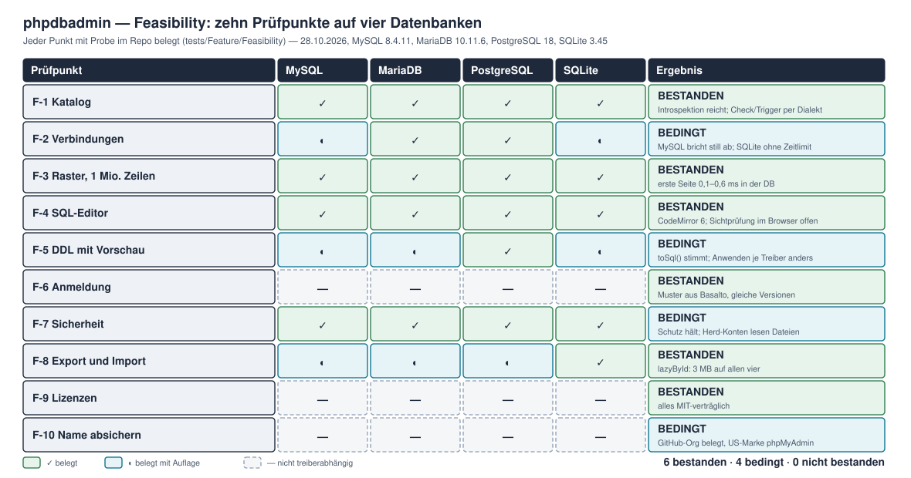
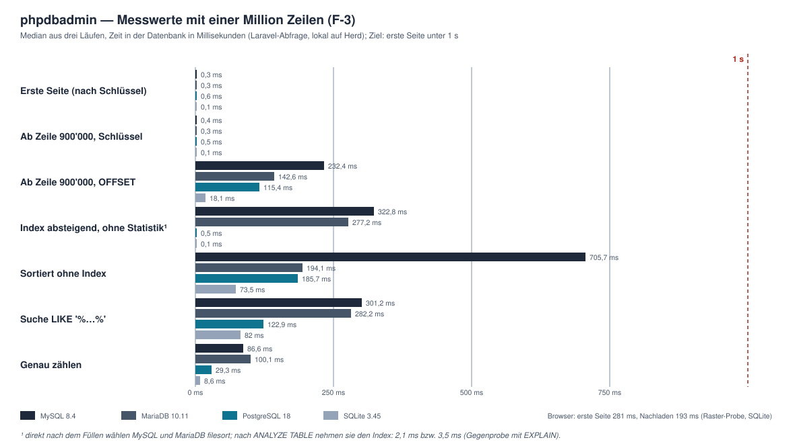
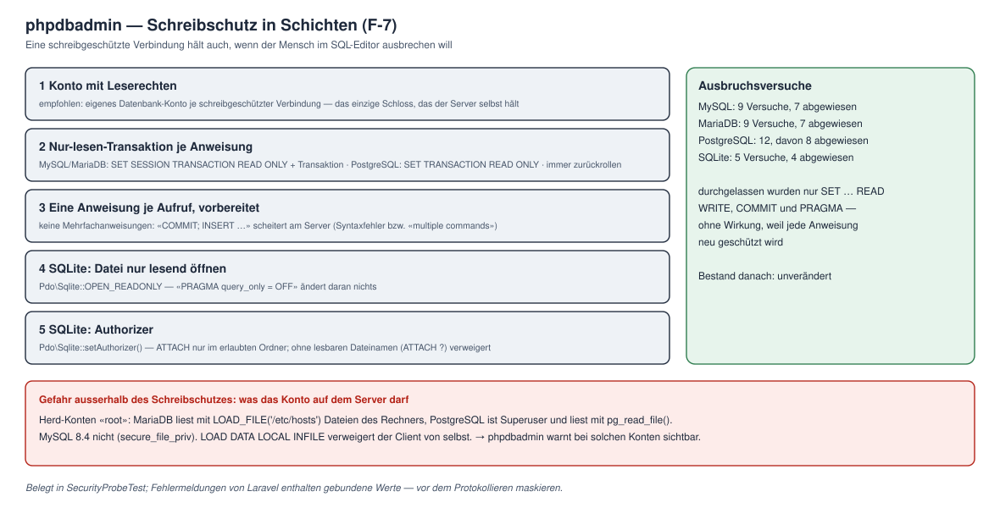

# Feasibility — phpdbadmin

> **Status:** v1.0 (28.10.2026) — **Feasibility abgeschlossen: alle zehn Prüfpunkte belegt.** F-1 (Katalog), F-3 (Raster), F-4 (SQL-Editor), F-6 (Anmeldung), F-8 (Export und Import) und F-9 (Lizenzen) **bestanden**; F-2 (Verbindungen), F-5 (DDL mit Vorschau), F-7 (Sicherheit) und F-10 (Name) **bedingt bestanden** — mit Auflagen, die in CR-001 Fassung 3 als Anforderungen stehen. **Empfehlung: Weiterführen** (§ 14). Eingang: [CR-001](../00-change_request/CR-001-phpdbadmin.md) Fassung 2, Entscheid «Feasibility starten» von Hoang am 28.10.2026. Ausgang: Terms of Reference v1.0, ADR-Kandidaten (§ 13), Foundation.

## 1. Zweck und Vorgehen

Die Feasibility prüft die zehn Punkte aus der [README](README.md), die das Produkt tragen und sich nicht nachrüsten lassen. Jeder Punkt bekommt einen **Nachweis** — eine Probe im Repo, die gegen **alle vier Datenbanken** läuft (`tests/Feature/Feasibility`), eine Messung oder eine Recherche mit Fundstellen —, ein **Ergebnis** (bestanden · bedingt · nicht bestanden) und seine **Folgen** für CR-001, Terms of Reference und ADRs.

**Prüfumgebung:** MacBook mit Laravel Herd · PHP 8.5.12 · Laravel 13.39 · **MySQL 8.4.11** (Port 3307, für die Probe in Herd installiert) · **MariaDB 10.11.6** · **PostgreSQL 18.0** · **SQLite 3.45.2**. Die Serverversionen lesen die Proben aus der Verbindung, nicht aus der Konfiguration. Zugang wie in Herd vorgegeben (`root` ohne Passwort) — genau das ist auch ein Befund (F-7).

## 2. Übersicht

| # | Prüfpunkt | Nachweis | Ergebnis |
|---|---|---|---|
| F-1 | **Katalog** — reicht die Introspektion von Laravel? | `CatalogProbeTest` (8 Proben) | **bestanden** |
| F-2 | **Verbindungen** — Zeitlimit, Abbrechen, Zeitzone, Fehler | `ConnectionProbeTest` (13 Proben) | **bedingt** — MySQL meldet Abbrüche still, SQLite kennt kein Zeitlimit |
| F-3 | **Raster** — 1 Mio. Zeilen, 1'000 Tabellen | `LargeTableProbeTest` (8 Proben, `PROBE_GROSS=1`), Raster-Probe im Browser | **bestanden** |
| F-4 | **SQL-Editor** — Dialekte, Vervollständigung | CodeMirror 6 installiert, Probe-Seite, `editor-completion-probe.mjs` | **bestanden** — Sichtprüfung im Browser durch Hoang offen |
| F-5 | **DDL mit Vorschau** — Vorschau = Ausführung? | `DdlPreviewProbeTest` (24 Proben) | **bedingt** — «Anwenden» braucht je Treiber ein eigenes Verfahren |
| F-6 | **Anmeldung** ohne Passwort | Quellcode Fortify 1.41, Vorlage Basalto mit gleichen Versionen | **bestanden** |
| F-7 | **Sicherheit** — Schreibschutz, Dateien, Meldungen | `SecurityProbeTest` (13 Proben) | **bedingt** — Schutz hält; Konten mit Dateirechten brauchen eine Warnung |
| F-8 | **Export und Import** grosser Daten | `LargeTableProbeTest` (4 Proben), RSS-Messung | **bestanden** |
| F-9 | **Lizenzen** — alles MIT-verträglich? | `composer licenses`, npm-Baum | **bestanden** |
| F-10 | **Name absichern** | Recherche mit Fundstellen ([Name und Marke](name-und-marke.md)) | **bedingt** — US-Marke «PHPMYADMIN», GitHub-Organisation belegt |

**Gesamtlauf am 28.10.2026:** `php artisan test` — 110 Tests: **98 bestanden, 12 übersprungen** (die schwere Probe ohne `PROBE_GROSS=1`, ausdrücklich so), 0 Fehlschläge, 0 Fehler. Schwere Probe separat (`PROBE_GROSS=1`, 2 min 10 s): erster Lauf 11 von 12 bestanden — rot war der Katalog auf MariaDB (§ 5, Befund 3); nach der Berichtigung (Schema ausdrücklich übergeben) die Katalog-Probe 4 von 4.

## 3. F-1 — Katalog

**Frage.** Reicht die Introspektion von Laravel 13 für Navigator und Strukturansicht auf vier Datenbanken, und was muss die Dialekt-Schicht selbst können?

**Nachweis.** `CatalogProbeTest`: Beispielschema mit Primärschlüssel, Unique- und zusammengesetztem Index, Fremdschlüssel mit `ON DELETE CASCADE`, Check-Constraint, Trigger, View, Kommentar, Enum, JSON, Dezimalzahl mit Vorgabe — je Treiber gelesen über `getTables()`, `getColumns()`, `getIndexes()`, `getForeignKeys()`, `getViews()`, `getTypes()`, `getSchemas()`; Check-Constraints und Trigger über eigene Abfragen.

**Befunde.**

| Befund | MySQL | MariaDB | PostgreSQL | SQLite |
|---|---|---|---|---|
| Tabellen, Spalten (Reihenfolge, NULL, Vorgabe, Autoincrement), Indizes, Fremdschlüssel, Views | ✓ | ✓ | ✓ | ✓ |
| Typ einer Spalte `json` | `json` | `longtext` | `json` | `text` |
| Typ einer Spalte `enum` | `enum('aktiv','gesperrt')` | `enum(…)` | `varchar(255)` + Check | `varchar` + Check |
| Spaltenkommentar | ✓ | ✓ | ✓ | — (kennt SQLite nicht) |
| `getTypes()` (eigene Typen) | Ausnahme | Ausnahme | ✓, liefert auch Array-Typ `_order_state` | Ausnahme |
| `getSchemas()` | eigene Datenbank | **alle Datenbanken des Servers** | `public` | `main` |
| Check-Constraints | `information_schema.CHECK_CONSTRAINTS` | dito | `pg_constraint` | nur aus dem `CREATE`-Text |
| Trigger | `information_schema.TRIGGERS` | dito | `pg_trigger` | `sqlite_schema` |

**Ergebnis: bestanden.** Laravel trägt den Grossteil; die Dialekt-Schicht ergänzt Check-Constraints, Trigger, eigene Typen (nur PostgreSQL, Array-Typen ausblenden) und Routinen. **Folge:** Der Katalog übergibt das Schema **immer** ausdrücklich — sonst listet MariaDB fremde Datenbanken (§ 5, Befund 3'603 Tabellen). Typnamen zeigt die Oberfläche je Treiber im Original und mit einem gemeinsamen Oberbegriff (Text, Zahl, Datum, JSON, …).

## 4. F-2 — Verbindungen

**Frage.** Lässt sich jede Anweisung zeitlich begrenzen und von aussen abbrechen? Stimmt die Zeitzone? Sind Verbindungsfehler für Menschen unterscheidbar?

**Nachweis.** `ConnectionProbeTest`: `SLEEP(5)` bzw. `pg_sleep(5)` unter einem Zeitlimit von 1 s; Abbrechen aus einer zweiten Verbindung (`KILL QUERY`, `pg_cancel_backend`) gegen einen echten Kindprozess; Zeitzone über die Verbindungskonfiguration; drei Fehlerfälle je Server.

**Befunde.**

| | MySQL 8.4 | MariaDB 10.11 | PostgreSQL 18 | SQLite |
|---|---|---|---|---|
| Zeitlimit | `max_execution_time` (nur SELECT) — **nach 1,01 s, aber still: Ergebnis `1`, kein Fehler** | `max_statement_time` — 1,01 s, Fehler 70100 | `statement_timeout` — 1,00 s, Fehler 57014 | **keines** — eine Abfrage über 3 Mio. Zeilen lief 1,2 s bis zum Ende |
| Abbrechen von aussen | `KILL QUERY` — nach 22 ms, **wieder still (`1`)** | nach 22 ms, Fehler 70100 | `pg_cancel_backend()` — nach 29 ms, Fehler 57014 | nicht möglich (PDO bietet kein Interrupt) |
| Zeitzone UTC über Konfiguration | `timezone => '+00:00'` ✓ | ✓ | `timezone => 'UTC'` ✓ | — |
| Host nicht erreichbar | 2002 | 2002 | 08006 «Connection refused» | — |
| Zugang verweigert | 1045 | 1045 | 08006 «role … does not exist» | — |
| Datenbank fehlt | 1049 | 1049 | 08006 «database … does not exist» | — |
| Passwort in der Meldung | nie | nie | nie | — |

**Ergebnis: bedingt bestanden.** **Folgen:** (1) Ob eine Abfrage abgebrochen wurde, weiss bei MySQL nur die Anwendung selbst — sie merkt sich den Abbruch und die Dauer und zeigt «abgebrochen» unabhängig vom Ergebnis (Q-02). (2) SQLite-Abfragen aus dem SQL-Editor laufen in einem eigenen Arbeitsprozess mit Zeitgrenze, der sich beenden lässt (neu **Q-09**). (3) PostgreSQL-Verbindungsfehler werden über den Meldungstext zugeordnet, MySQL/MariaDB über den Code (V-02).

## 5. F-3 — Raster mit einer Million Zeilen

**Frage.** Erscheint die erste Seite einer Tabelle mit einer Million Zeilen unter einer Sekunde? Bleibt der Navigator mit 1'000 Tabellen flüssig? Trägt ein virtualisiertes Raster im Browser?

**Nachweis.** `LargeTableProbeTest` füllt je Treiber eine Tabelle mit 1'000'000 Zeilen (Kreuzprodukt einer Zifferntabelle, 3,5–8,2 s) und misst sieben Abfragen (Median aus drei Läufen); eine zweite Probe legt 1'000 Tabellen an. Im Browser: Probe-Seite `/probe/raster` (nur lokal) mit `@tanstack/vue-virtual`, Nachladen in Seiten zu 200 Zeilen über den Schlüssel.

**Befunde.**

1. **Erste Seite und tiefe Seiten über den Schlüssel: 0,1–0,6 ms** auf allen vier — weit unter dem Ziel. Über `OFFSET 900000` dagegen 18–232 ms: Blättern geht über den Schlüssel, `OFFSET` nur für Tabellen ohne Primärschlüssel.
2. **Sortieren über einen Index** war auf MySQL und MariaDB zuerst 277–323 ms. Gegenprobe mit `EXPLAIN`: Direkt nach dem Füllen fehlt die Statistik, der Optimierer wählt `filesort`; nach `ANALYZE TABLE` nimmt er den Index — 2,1 ms bzw. 3,5 ms. Folge: nach eigenen Importen die Statistik aktualisieren und «Statistik aktualisieren» anbieten (neu **E-06**).
3. **Katalog mit 1'000 Tabellen:** `getTables()` mit Schema 1–13 ms, `getColumns()` je Tabelle 0,1–0,6 ms. **Ohne Schemaangabe liefert MariaDB 3'603 Tabellen** — die aller Datenbanken des Servers (hier: Basalto und weitere Projekte). Die Probe war deshalb zuerst rot; mit Schema 8 ms.
4. **Zeilenzahl:** genau zählen 9–100 ms; Schätzung aus der Statistik (`TABLE_ROWS`, `reltuples`, `sqlite_stat1`) 996'360 bis 1'000'000, also innerhalb 0,4 %.
5. **Browser:** erste Seite nach 281 ms, nächste nach 193 ms — davon 4,9 bzw. 3,9 ms Datenbank, der Rest ist Laravel und Herd je Anfrage. Im DOM stehen rund 25 Zeilen, auch wenn 400 geladen sind. Folge: die nächste Seite vorladen, bevor das Ende sichtbar wird.

**Ergebnis: bestanden.**

## 6. F-4 — SQL-Editor

**Frage.** Trägt CodeMirror 6 die Hervorhebung und Vervollständigung je Dialekt mit einem grossen Schema, und was kostet es im Bündel?

**Nachweis.** Pakete probeweise installiert (Freigabe Hoang 28.10.2026): `codemirror` 6.0.2, `@codemirror/lang-sql` 6.10.0 (17 Pakete, alle MIT, nichts herabgestuft, 0 Schwachstellen). Probe-Seite `/probe/editor` (nur lokal) mit Dialektwahl; `tests/Feature/Feasibility/editor-completion-probe.mjs` prüft die Vervollständigung ohne Browser.

**Befunde.**

- **Vervollständigung** auf allen vier Dialekten: Tabellen aus einem Schema mit 1'002 Tabellen in höchstens 2 ms, Alias aufgelöst (`o.` in `FROM orders o` liefert die Spalten von `orders`), Spalten nach `customers.`.
- **Dialekt zählt:** `ILIKE` wird nur bei PostgreSQL angeboten — zugleich die Gegenprobe, dass der Dialekt wirkt.
- **Bündel:** Editor-Seite 425 KB (138 KB gzip), eigener Chunk — wird nur geladen, wenn der SQL-Reiter offen ist.
- **Sichtprüfung im eingebauten Browser nicht möglich:** Seit 15:35 läuft `php artisan dev` mit Vite auf Port 5173 (aus einem Terminal gestartet), und der eingebaute Browser blockiert fremde Ports. Die Raster-Seite lief kurz davor noch über den Build.

**Ergebnis: bestanden** — die Sichtprüfung (Tippen, Vorschlagsliste, Dialektwechsel) unter `https://phpdbadmin.test/probe/editor` übernimmt Hoang.

## 7. F-5 — DDL mit Vorschau

**Frage.** Ist die Vorschau genau das SQL, das danach läuft — auch beim Tabellenumbau von SQLite? Wo lässt sich eine Folge von Änderungen zurückrollen?

**Nachweis.** `DdlPreviewProbeTest`: Tabelle anlegen und ändern (umbenennen, Typ ändern, Spalte löschen und anlegen, Index) über `Blueprint::toSql()`, ausgeführt Anweisung für Anweisung und mitgeschnitten; `pretend()` für DML und DDL; eine absichtlich scheiternde Folge; Umbau einer Elterntabelle mit abhängigen Zeilen — naiv und je Treiber.

**Befunde.**

1. **`toSql()` = Ausführung** auf allen vier (Mitschnitt identisch). Eine Änderung mit fünf Schritten wird auf MySQL/MariaDB zu 5, auf PostgreSQL zu 6, auf SQLite zu 11 Anweisungen (Kopie, Daten, Umbenennen, Indizes neu). Daten und Unique-Index überleben den Umbau.
2. **`pretend()` taugt für DML** (Werte lesbar eingesetzt, Bindungen getrennt, nichts geschrieben), **nicht für SQLite-DDL**: Die Lesezugriffe der Grammatik liefern dort leer, heraus kommt `create table "__temp__probe_items" ()`. Die Vorschau kommt deshalb aus `toSql()`.
3. **Rückrollen:** PostgreSQL und SQLite rollen DDL zurück; MySQL/MariaDB schliessen die Transaktion bei DDL implizit ab — die erste Tabelle bleibt nach einem Fehler in der zweiten Anweisung.
4. **Naiv alles in eine Transaktion** ist gefährlich: MySQL/MariaDB schreiben die Änderung und Laravel wirft danach «There is no active transaction»; **SQLite löscht beim Umbau der Elterntabelle alle abhängigen Zeilen** (0 von 2), weil `PRAGMA foreign_keys = 0` innerhalb einer Transaktion nicht wirkt und `DROP TABLE` per `ON DELETE CASCADE` löscht.
5. **Je Treiber richtig angewendet** bleiben 2 von 2 Kindern: MySQL/MariaDB Anweisung für Anweisung ohne Transaktion; PostgreSQL in einer Transaktion; SQLite nach dem Verfahren von sqlite.org (Fremdschlüssel ausserhalb der Transaktion aus, Umbau, `foreign_key_check`, Commit, wieder ein).

**Ergebnis: bedingt bestanden.** **Folgen:** S-02, S-03, D-04 und N-03 bekommen die Abnahme «je Treiber angewendet, mit Elterntabelle und Kindern getestet»; die Vorschau sagt bei MySQL/MariaDB «nicht rückrollbar» (ADR-Kandidat 3).

## 8. F-6 — Anmeldung ohne Passwort

**Frage.** Lässt sich Fortify 1.41 auf Passkeys beschränken, und was kostet die Code-Anmeldung?

**Nachweis.** `vendor/laravel/fortify/routes/routes.php` gelesen; Vorlage Basalto (eigenes Projekt) mit **denselben Versionen** (Fortify 1.41.0, `laravel/passkeys` 0.2.1): Code-Anmeldung (`LoginController`, 170 Zeilen), Abweisung des Passwort-Logins über `Fortify::authenticateUsing()`, Software-Authenticator für Tests der Passkey-Zeremonie (123 Zeilen).

**Befunde.** Fortify registriert **unabhängig von den Features** `POST /login`, `POST /logout`, `GET/POST /user/confirm-password` und `GET /user/confirmed-password-status`. Diese Wege müssen ausdrücklich abgewiesen werden (Basalto: `authenticateUsing()` liefert `null`). Das Feature `passkeys` steht im Starter-Kit mit `confirmPassword: true` — das verlangt ein Passwort vor dem Anlegen eines Passkeys und muss auf Bestätigung per Passkey bzw. Code umgestellt werden. Bekannte Fallen aus Basalto: Ein Minor-Update von Fortify übernahm Routen von `laravel/passkeys`; `{passkey}` ist global an das Passkey-Modell gebunden.

**Ergebnis: bestanden.** Umsetzung in TB 00, Schätzung 1–1,5 PT mit Tests.

## 9. F-7 — Sicherheit

**Frage.** Hält ein Schreibschutz, wenn der Mensch im SQL-Editor ausbrechen will? Welche Gefahren bringt freies SQL sonst mit?

**Nachweis.** `SecurityProbeTest`: je Treiber 5–12 Ausbruchsversuche (`SET … READ WRITE`, `COMMIT`, Mehrfachanweisungen, DDL, `DO`-Block, `nextval()`, `PRAGMA query_only = OFF`) gegen einen Wächter; SQLite-Authorizer gegen `ATTACH`; Kontorechte; `LOAD DATA LOCAL INFILE`; Inhalt von Fehlermeldungen. Bedrohungen und Gegenmittel im Überblick: [Sicherheit und Bedrohungen](sicherheit-und-bedrohungen.md).

**Befunde.**

1. **Der Wächter hält auf allen vier:** eine Anweisung je Aufruf, vorbereitet, in einer Nur-lesen-Transaktion, immer zurückgerollt; SQLite mit `Pdo\Sqlite::OPEN_READONLY`. Durchgelassen wurden nur `SET … READ WRITE`, `COMMIT` und `PRAGMA` — ohne Wirkung, weil jede Anweisung neu geschützt wird. Bestand danach unverändert, keine Tabelle angelegt.
2. **Mehrfachanweisungen** scheitern am Server, solange vorbereitete Anweisungen genutzt werden (Laravel: `ATTR_EMULATE_PREPARES = false`). `unprepared()` ist für den SQL-Editor tabu.
3. **SQLite-Authorizer** (`Pdo\Sqlite::setAuthorizer()`, neu in PHP 8.5): `ATTACH` ausserhalb des erlaubten Ordners verweigert; bei `ATTACH ?` kennt er den Dateinamen beim Vorbereiten nicht — wird ebenfalls verweigert.
4. **Konten mit Dateirechten:** Herd-`root` auf MariaDB liest mit `LOAD_FILE('/etc/hosts')` Dateien des Rechners; PostgreSQL-`root` ist Superuser und liest mit `pg_read_file()`. MySQL 8.4 nicht (`secure_file_priv`). Folge: phpdbadmin erkennt solche Konten und warnt sichtbar (neu **V-10**).
5. `LOAD DATA LOCAL INFILE` verweigert der MySQL-Client von selbst (Fehler 3948).
6. **Laravel setzt gebundene Werte in die Fehlermeldung ein** — ein Fehler bei `INSERT … 'Geheimwert'` trägt den Wert in die Meldung und damit ins Protokoll. Folge: Meldungen vor dem Speichern und Anzeigen maskieren (B-04, N-02).

**Ergebnis: bedingt bestanden.** Auflagen: V-10 (Kontowarnung), Maskierung der Meldungen, Empfehlung «eigenes Lesekonto» in der Oberfläche.

## 10. F-8 — Export und Import

**Frage.** Lässt sich eine Million Zeilen exportieren, ohne den Speicher zu sprengen, und wie schnell ist ein Import in Paketen?

**Nachweis.** `LargeTableProbeTest`: CSV-Export mit `lazyById(5000)`, mit `cursor()` und — bei MySQL/MariaDB — mit ungepuffertem `cursor()`; Import von 100'000 Zeilen in Paketen zu 1'000. Für PostgreSQL zusätzlich die Prozessgrösse gemessen, weil `memory_get_usage()` nur PHP-Speicher sieht.

**Befunde.**

| | MySQL | MariaDB | PostgreSQL | SQLite |
|---|---|---|---|---|
| `lazyById(5000)` | 4,9 s · 3,3 MB | 3,5 s · 3,2 MB | 3,8 s · 3,0 MB | 3,4 s · 2,8 MB |
| `cursor()` gepuffert | 8,1 s · **62 MB** | 3,8 s · **62 MB** | 3,9 s · PHP 0 MB, **Prozess +105 MB** (libpq) | 3,8 s · 0 MB (streamt) |
| `cursor()` ungepuffert | 8,1 s · 0,1 MB | 3,5 s · 0,1 MB | — | — |
| Import 100'000 Zeilen | 413 ms | 466 ms | 502 ms | 143 ms |

**Ergebnis: bestanden.** **Folge:** Export immer in Paketen über den Schlüssel (`lazyById`), im Hintergrund (E-01); ungepufferte Cursor blockieren die Verbindung für andere Abfragen und bleiben die Ausnahme. Abnahme E-01: unter 64 MB bei einer Million Zeilen.

## 11. F-9 — Lizenzen

**Nachweis.** `composer licenses --no-dev`: 101 Pakete — MIT 91, BSD-3-Clause 7, BSD-2-Clause 2, Apache-2.0 1; `nette/schema` und `nette/utils` stehen unter BSD-3-Clause **oder** GPL — BSD-3 wird gewählt. npm-Baum der Laufzeitabhängigkeiten: MIT, ISC, BSD, Apache-2.0; `lightningcss` (MPL-2.0) ist ein Bauwerkzeug und wird nicht ausgeliefert; 57 Einträge ohne Angabe sind nicht installierte Plattform-Binärdateien. Neu: CodeMirror, Lezer, TanStack Virtual — alle MIT.

**Ergebnis: bestanden.** Die Lizenzliste wird vor jedem Release erneut erzeugt.

## 12. F-10 — Name absichern

**Nachweis.** Recherche mit Fundstellen und Prüfart: [Name und Marke](name-und-marke.md).

**Befunde.** Eingetragen ist die Marke **PHPMYADMIN** der Software Freedom Conservancy — nur in den USA (Klasse 9); in der EU, der Schweiz und bei der WIPO kein Eintrag gefunden (TMview, kein amtliches Register). «phpdbadmin» ist in keinem durchsuchten Register eingetragen. Belegt sind die **GitHub-Organisation `phpdbadmin`** (leer, seit 2022) und das ruhende Projekt **`cclark61/phpdbadmin`** (GPL-3, letzter Push 04/2023). `phpdbadmin.com` ist abgelaufen und in der Wiederherstellungsfrist; `.ch`, `.org`, `.net`, `.io`, `.dev` sind frei. Packagist, npm und Docker Hub: frei.

**Ergebnis: bedingt bestanden.** Auflagen vor dem ersten öffentlichen Auftritt: Domains sichern (Hoang), Repo unter `hoang-79/phpdbadmin`, Hinweis «nicht verbunden mit phpMyAdmin» in README und Website, kein Logo oder Satz, der eine Nähe zu phpMyAdmin behauptet.

## 13. Folgen für Anforderungen und Architektur

**Neue Anforderungen (CR-001 Fassung 3):** V-10 Warnung bei Konten mit Superuser- oder Dateirechten · Q-09 SQLite-Abfragen im Arbeitsprozess mit Zeitgrenze · E-06 Statistik aktualisieren nach Import und auf Knopfdruck.

**Geänderte Abnahmen:** V-02 (Zuordnung je Treiber) · V-04/Q-03 (Schreibschutz in Schichten) · Q-02 (Abbruch auch ohne Fehlercode erkannt) · D-04, S-02, S-03, N-03 (Anwenden je Treiber, mit Elterntabelle und Kindern) · E-01 (`lazyById`, unter 64 MB) · O-01 (Schema immer übergeben) · B-04, N-02 (Meldungen maskiert).

**ADR-Kandidaten für die Foundation:**

| Nr. | Entscheid (Vorschlag) | Grundlage |
|---|---|---|
| ADR-001 | Dialekt-Schicht: ein Vertrag, vier Umsetzungen; Laravel-Introspektion zuerst, Schema immer ausdrücklich | F-1, F-3 |
| ADR-002 | Zielverbindungen je Anfrage über `DB::build()`, Sitzungswerte (UTC, Zeitlimit) aus der Konfiguration | F-2 |
| ADR-003 | Vorschau aus `Blueprint::toSql()`, Anwenden je Treiber (MySQL einzeln, PostgreSQL Transaktion, SQLite Umbauverfahren) | F-5 |
| ADR-004 | Schreibschutz in Schichten: Lesekonto empfohlen, Nur-lesen-Transaktion je Anweisung, vorbereitet, SQLite `OPEN_READONLY` + Authorizer | F-7 |
| ADR-005 | SQL-Editor: CodeMirror 6 mit `@codemirror/lang-sql`, eigener Chunk | F-4 |
| ADR-006 | Raster: `@tanstack/vue-virtual`, Blättern über den Schlüssel, nächste Seite vorladen | F-3 |
| ADR-007 | Export und Import: Pakete über den Schlüssel im Hintergrund, Statistik nach Import | F-8, F-3 |
| ADR-008 | Anmeldung: Fortify nur für Passkeys, eigener Code-Login, Passwort-Endpunkte abgewiesen | F-6 |
| ADR-009 | App-Datenbank SQLite als Vorgabe | R-31 |
| ADR-010 | Lizenz MIT, Abhängigkeiten MIT-verträglich | F-9, R-40 |

## 14. Empfehlung

**Weiterführen.** Kein Prüfpunkt ist gescheitert; die vier bedingten Punkte haben klare Auflagen, die als Anforderungen in CR-001 stehen und den Aufwand um schätzungsweise 2–3 PT erhöhen (Arbeitsprozess für SQLite, Anwenden je Treiber, Kontowarnung, Maskierung). Die Schätzung bis v1.2 steigt damit auf rund 42–53 PT. Als Nächstes: Terms of Reference v1.0 verabschieden, dann Foundation (Gestaltung, PRL, Architektur, Datenmodell, Timebox-Plan, ADRs).

## 15. Was die Proben nicht abdecken

- Kein Lasttest mit mehreren gleichzeitigen Personen; gemessen wurde eine Anfrage nach der anderen auf einem Rechner.
- Server-Versionen nur je eine (MySQL 8.4, MariaDB 10.11, PostgreSQL 18); die Untergrenzen (R-15) prüft die Pipeline-Matrix.
- SSH-Tunnel, TLS zur Datenbank und die Hosts-Liste gegen SSRF sind beschrieben ([Sicherheit und Bedrohungen](sicherheit-und-bedrohungen.md)), aber nicht als Probe gebaut.
- Die Probe-Seiten `/probe/raster` und `/probe/editor` sind nur lokal geladen und werden in TB 00 übernommen oder entfernt.
