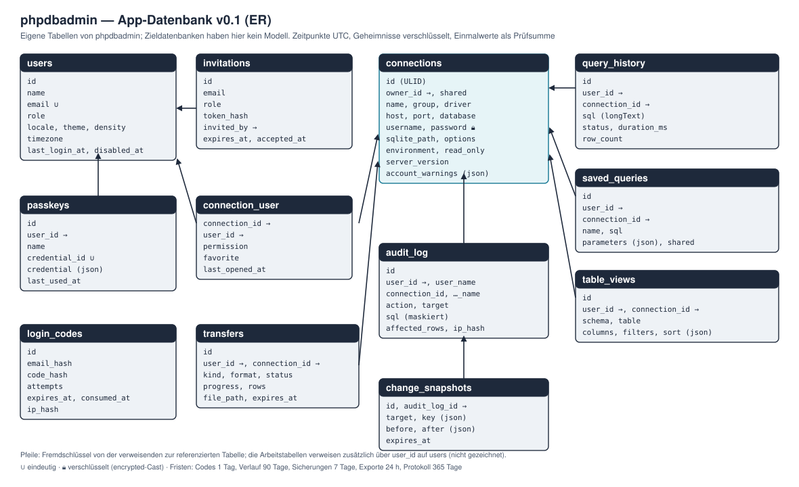

# Datenmodell — App-Datenbank v0.1

**Stand:** 28.10.2026 · v0.1 (Foundation). Beschreibt die **eigene Datenbank von phpdbadmin** — Konten, Passkeys, Verbindungen, Rechte, Verlauf, Protokoll. Die verwalteten Datenbanken sind Umsysteme und haben hier kein Modell. Vorgabe ist SQLite (ADR-009); MariaDB, MySQL und PostgreSQL sind möglich (B-06), deshalb gelten die Regeln in § 1 für alle vier.

## 1. Grundsätze

1. **Kein Passwort** für Konten: `users` hat keine Spalten `password`, `remember_token`, `two_factor_*`; die Tabelle `password_reset_tokens` entfällt (A-01).
2. **Geheimnisse verschlüsselt** mit dem `encrypted`-Cast (`APP_KEY`): Passwörter der Zielverbindungen, Schlüssel für SSH und KI. Ein Wechsel des `APP_KEY` macht sie unlesbar — der Betrieb kennt `APP_PREVIOUS_KEYS` (B-05).
3. **Nur Prüfsummen für Einmalwerte:** Anmeldecodes und Einladungstoken als Hash (`hash_hmac` mit `APP_KEY`), nie im Klartext; IP-Adressen als Prüfsumme.
4. **Zeitpunkte** als `dateTime` in UTC, nie `timestamp NOT NULL` ohne Vorgabe (MariaDB 10.6 setzt sonst still `ON UPDATE CURRENT_TIMESTAMP`); Anzeige in der Zeitzone des Kontos.
5. **Lange Texte** (SQL, Fehlermeldungen, Vorher-Werte) als `longText` — `TEXT` endet auf MySQL/MariaDB bei 64 KB.
6. **JSON** als `json`; Tests vergleichen JSON mit `assertEquals`, nie mit `assertSame` (MySQL ordnet Schlüssel um).
7. **Kennungen:** `connections` mit ULID (die Kennung steht in Adressen und darf nichts über die Anzahl verraten); übrige Tabellen mit fortlaufender Nummer.
8. **Aufbewahrung** beim Anlegen mitgebaut: Verlauf, Protokoll, Rückgängig-Sicherungen und Exportdateien haben eine Frist und einen täglichen Aufräumlauf (`model:prune`).
9. **Kein Datenbankfehler ins eigene Protokoll** schreiben, wenn das Protokoll selbst in der App-Datenbank liegt (Rückkopplung) — Fehler der App-Datenbank gehen nur ins Log.

## 2. Tabellen

### 2.1 Konten und Anmeldung

| Tabelle | Spalten (Auswahl) | Zweck |
|---|---|---|
| `users` | `id`, `name`, `email` (eindeutig, klein geschrieben), `role` (`admin` · `member`), `locale`, `theme` (`system` · `light` · `dark`), `density` (`default` · `compact`), `timezone`, `last_login_at`, Zeitstempel | Konto ohne Passwort; Name und E-Mail ändert ein Administrator (A-05) |
| `passkeys` | `id`, `user_id`, `name`, `credential_id` (eindeutig), `credential` (json), `last_used_at`, Zeitstempel | aus `laravel/passkeys`, unverändert (A-03) |
| `login_codes` | `id`, `email_hash`, `code_hash`, `attempts`, `expires_at`, `consumed_at`, `ip_hash`, `created_at` | Anmeldung per Code: sechs Ziffern, 10 Minuten, einmalig (A-02); unbekannte Adressen bekommen keinen Datensatz, aber dieselbe Antwort |
| `invitations` | `id`, `email`, `role`, `token_hash`, `invited_by`, `expires_at`, `accepted_at`, Zeitstempel | Einladung statt Registrierung (A-06) |
| `sessions` | wie Laravel | Sitzungen sehen und beenden (A-08) |

### 2.2 Verbindungen und Rechte

| Tabelle | Spalten (Auswahl) | Zweck |
|---|---|---|
| `connections` | `id` (ULID), `owner_id`, `shared` (bool), `name`, `group`, `driver` (`mysql` · `mariadb` · `pgsql` · `sqlite`), `host`, `port`, `database`, `username`, `password` (verschlüsselt, leer bei «nicht speichern»), `store_password` (bool), `sqlite_path`, `options` (json: SSL-Modus, Zeichensatz, Suchpfad), `environment` (`local` · `test` · `production`), `read_only` (bool), `server_version`, `account_warnings` (json, V-10), `last_tested_at`, Zeitstempel | Zielverbindung (V-01 bis V-05, V-09, V-10) |
| `connection_user` | `connection_id`, `user_id`, `permission` (`read` · `write` · `manage`), `favorite` (bool), `last_opened_at` | Recht je Verbindung und Konto, Favoriten (A-07, V-06) |

Regeln: Produktion ist beim Anlegen `read_only = true` (V-04). Eine persönliche Verbindung (`shared = false`) sieht nur ihr Besitzer; geteilte Verbindungen nur, wer in `connection_user` steht (V-09). `host` und `sqlite_path` werden beim Speichern **und** beim Verbinden gegen die erlaubten Hosts und Ordner geprüft (V-05).

### 2.3 Arbeit: Verlauf, gespeicherte Abfragen, Ansichten

| Tabelle | Spalten (Auswahl) | Zweck |
|---|---|---|
| `query_history` | `id`, `user_id`, `connection_id`, `sql` (longText), `status` (`ok` · `error` · `cancelled` · `timeout`), `duration_ms`, `row_count`, `created_at` | Verlauf je Konto und Verbindung (Q-04); Frist 90 Tage |
| `saved_queries` | `id`, `user_id`, `connection_id` (nullable), `name`, `sql`, `parameters` (json), `shared` (bool), Zeitstempel | gespeicherte Abfragen (Q-04) |
| `table_views` | `id`, `user_id`, `connection_id`, `schema`, `table`, `columns` (json: Reihenfolge, Breite, ausgeblendet), `filters` (json), `sort` (json), Zeitstempel | gemerkte Ansicht je Tabelle (D-01, D-02) — gespeichert wird die Wahl, nicht das Ergebnis |

### 2.4 Änderungen, Protokoll, Austausch

| Tabelle | Spalten (Auswahl) | Zweck |
|---|---|---|
| `audit_log` | `id`, `user_id`, `connection_id`, `action` (z. B. `data.update`, `schema.alter`, `sql.execute`, `auth.login`), `target` (Schema.Tabelle), `sql` (longText, Werte maskiert), `affected_rows`, `ip_hash`, `created_at` | Protokoll aller schreibenden Aktionen und Anmeldungen (B-04, A-09); Frist einstellbar, Vorgabe 365 Tage |
| `change_snapshots` | `id`, `audit_log_id`, `user_id`, `connection_id`, `target`, `key` (json: Primärschlüssel), `before` (json), `after` (json), `expires_at` | Rückgängig für Datenänderungen (D-09): Vorher-Werte bis zur Grenze (Vorgabe 1'000 Zeilen je Änderung, 7 Tage) |
| `transfers` | `id`, `user_id`, `connection_id`, `kind` (`export` · `import`), `format`, `status` (`queued` · `running` · `done` · `failed`), `progress`, `rows`, `file_path`, `error`, `expires_at`, Zeitstempel | Export und Import im Hintergrund (E-01, E-02); Dateien unter `storage/app/private/transfers`, Frist 24 Stunden |
| `jobs`, `failed_jobs`, `cache` | wie Laravel | Warteschlange, Abbruch-Merker laufender Abfragen (Q-02) |

## 3. Was bewusst fehlt

- **Kein Abbild der Zieldatenbanken:** Katalog, Zeilenzahlen und Struktur werden je Anfrage gelesen, höchstens kurz zwischengespeichert (Cache mit Ablauf) — nie in Tabellen, die veralten.
- **Kein Klartext gebundener Werte im Protokoll:** `audit_log.sql` speichert die Anweisung mit Platzhaltern bzw. maskierten Werten; die Werte selbst stehen nur in `change_snapshots` (mit Frist) — so bleibt Rückgängig möglich, ohne dass das Protokoll Daten sammelt.
- **Keine Rechte auf Tabellenebene:** dafür sind die Konten der Datenbank-Server da (Sicherheit und Bedrohungen § 3).

## 4. Löschen und Aufräumen

| Was | Wann | Wie |
|---|---|---|
| Anmeldecodes | nach Verbrauch oder 10 Minuten, Datensatz nach 1 Tag | `model:prune` |
| Einladungen | nach Annahme oder Ablauf (7 Tage), Datensatz nach 30 Tagen | `model:prune` |
| Verlauf | 90 Tage | `model:prune` |
| Rückgängig-Sicherungen | 7 Tage | `model:prune` |
| Exportdateien | 24 Stunden | Aufräumlauf löscht Datei und setzt `file_path` leer |
| Protokoll | Einstellung, Vorgabe 365 Tage | `model:prune` |
| Konto gelöscht | Passkeys, Sitzungen, persönliche Verbindungen, Verlauf, gespeicherte Abfragen mit; Protokolleinträge bleiben mit `user_id = null` und Name im Eintrag | Fremdschlüssel `cascadeOnDelete` bzw. `nullOnDelete` |

## 5. Offene Punkte

- Einstellbare Fristen: global in der Konfiguration oder im Verwaltungsbereich? Vorschlag: Konfiguration (`.env`), angezeigt in der Verwaltung (TB 07).
- KI-Schlüssel (Q-08, Stufe 4) — Tabelle oder Spalte am Konto, erst in TB 12.
