# Wireframes — phpdbadmin

**Stand:** 28.10.2026 · v0.1 — Fragen F-1 bis F-6 von Hoang am 28.10.2026 entschieden (siehe unten), Raster auf Endlos-Scrollen umgestellt; die Sichtprüfung am echten Bildschirm folgt mit TB 00. Grundlage: [Gestaltung](../gestaltung.md) (verbindlich), [CR-001 § 3.3 und § 4](../../00-change_request/CR-001-phpdbadmin.md), [Produktprinzipien P-01 bis P-11](../../00-change_request/ideensammlung.md#6-wie--produktprinzipien-vorschlag), Befunde der [Feasibility](../../02-feasibility/feasibility.md) und die Skizze [Bedienkonzept](../../00-change_request/diagrams/bedienkonzept.svg).

## Zweck

Die Wireframes zeigen jeden Kernbildschirm von phpdbadmin auf dem Desktop (1440 × 900) und auf dem Telefon (375 × 812), in der Gestaltung der Foundation: Farben, Umgebungen, Rasterzustände, Typografie und Bausteine. Sie sind die Vorlage für die Umsetzung in Vue und die Abnahme je Bildschirm. Alle Daten sind erfunden (Kunden «Anna Muster», «Beat Keller» …, Team «Nina Brügger», «Reto Imhof», «Sandra Kälin»); echt ist nur das Konto von Hoang.

**Übersicht zum Durchblättern:** [index.html](index.html) — alle Bereiche, Desktop und Mobil nebeneinander, mit Links auf die HTML-Seiten.

## Aufruf

```bash
cd dokumentationen/03-foundation/mockups
python3 mockup-bauen.py               # alles neu: Seiten, Bilder, index.html
python3 mockup-bauen.py --ohne-bilder # nur HTML (schnell, ohne Chrome)
python3 mockup-bauen.py --nur 05,06   # nur diese Bereiche
```

- **Voraussetzungen:** Python 3.11+ mit Pillow (nur für das Zuschneiden der mobilen Aufnahmen), Google Chrome unter `/Applications/Google Chrome.app`. Inter und JetBrains Mono werden genommen, wenn sie auf dem Rechner installiert sind; sonst greift die Ersatzschrift (`system-ui` bzw. `Menlo`).
- **Farben** liest der Generator aus [`werkzeuge/kontraste.py`](../../werkzeuge/kontraste.py) — der einzigen Quelle der Palette. Ändert sich dort eine Farbe, genügt ein neuer Lauf.
- **Seiten** (`seiten/*.html`) sind statisch: eingebettetes CSS, kein JavaScript, keine Netzwerkzugriffe. Jeder Selektor beginnt mit `.mk-`.
- **Aufnahmen** macht Chrome headless (vier gleichzeitig). Desktop direkt in 1440 × 900; Mobil in einem 500 px breiten Fenster (Chrome klemmt schmalere Fenster) mit festem 375-px-Rahmen, danach mit Pillow auf 375 × 812 zugeschnitten. Veraltete Bilder löscht ein voller Lauf.
- Dauer: meist unter einer Minute; im Hintergrund gedrosselt kann ein Lauf deutlich länger dauern.

## Bereiche

37 Bilder: 14 × Desktop, 14 × Mobil und 9 Zusatzbilder (Zustände, Dunkelmodus, zweiter Treiber).

| Nr. | Titel | Inhalt | Anforderungen | Bilder |
|---|---|---|---|---|
| 01 | Anmeldung | «Mit Passkey anmelden» als Hauptknopf, darunter E-Mail-Adresse und «Code senden»; Sprache wählbar, keine Registrierung, kein Passwort | A-01, A-02, A-03, A-06 | [Desktop](bilder/01-anmeldung-desktop.png) · [Mobil](bilder/01-anmeldung-mobil.png) |
| 02 | Code eingeben | Ein Feld für sechs Ziffern, «Code erneut senden» mit Wartezeit; Fehlerzustand «Code abgelaufen» mit nächstem Schritt | A-02 | [Desktop](bilder/02-code-desktop.png) · [Mobil, abgelaufen](bilder/02-code-mobil.png) · [Desktop, abgelaufen](bilder/02-code-desktop-abgelaufen.png) |
| 03 | Startseite: Verbindungen | Statt Dashboard: Verbindungen in Gruppen, Umgebung mit Symbol und Wort, Treiber-Schild, Schloss bei Schreibschutz, Favoriten, Kontowarnung V-10 an «lokal · basalto», «Verbindung anlegen», zuletzt Geöffnetes | A-04, V-04, V-06, V-10 | [Desktop](bilder/03-verbindungen-desktop.png) · [Mobil](bilder/03-verbindungen-mobil.png) |
| 04 | Verbindung anlegen | Treiber als vier Kacheln, Felder je Treiber, Umgebung, Schreibschutz, «Passwort nicht speichern», Test in Schritten. Desktop: MySQL auf Produktion mit «Zugang verweigert (1045)»; Mobil: SQLite-Datei im erlaubten Ordner, Test erfolgreich mit Version | V-01 bis V-05 | [Desktop](bilder/04-verbindung-anlegen-desktop.png) · [Mobil](bilder/04-verbindung-anlegen-mobil.png) |
| 05 | Arbeitsbildschirm Daten | Nach der Skizze: Produktions-Chip und roter Streifen, Schreibfreigabe auf Zeit, Befehlspalette-Feld, Navigator, Reiter mit Umgebung, Filter-Chips, Raster mit geänderten Zellen, neuer Zeile, Zeile zum Löschen, NULL, Fremdschlüssel-Pfeil, Änderungsleiste, «Rückgängig» der letzten Anwendung | O-01 bis O-04, D-01 bis D-04, D-06, D-09, V-04 | [Desktop](bilder/05-arbeitsbildschirm-desktop.png) · [Mobil](bilder/05-arbeitsbildschirm-mobil.png) · [Desktop dunkel](bilder/05-arbeitsbildschirm-desktop-dunkel.png) · [Mobil dunkel](bilder/05-arbeitsbildschirm-mobil-dunkel.png) · [Mobil, Navigator als Schublade](bilder/05-arbeitsbildschirm-mobil-navigator.png) |
| 06 | SQL-Vorschau vor dem Anwenden | Schublade mit jeder Anweisung, gezählten Zeilen und Folgen (ON DELETE CASCADE), Hinweis je Treiber (MySQL/InnoDB: in einer Transaktion), Bestätigung mit Namenseingabe auf Produktion — Desktop halb getippt (Knopf aus), Mobil fertig (Knopf aktiv) | D-04, D-09, Q-07, N-03 | [Desktop](bilder/06-sql-vorschau-desktop.png) · [Mobil](bilder/06-sql-vorschau-mobil.png) |
| 07 | Zeilen-Detail-Schublade | Alle Felder mit Typ, geänderter Wert mit Vorher-Wert, JSON formatiert und geprüft, NULL gegen leer, Binärwert mit Grösse und Herunterladen, Zeitzone, Verweise vor und zurück, «Zeile kopieren als» | D-03, D-05, E-05 | [Desktop](bilder/07-zeilen-detail-desktop.png) · [Mobil](bilder/07-zeilen-detail-mobil.png) |
| 08 | Struktur einer Tabelle | Spalten mit Originaltyp und gemeinsamer Art, Kollation, Kommentar; Indizes, Fremdschlüssel samt eingehender Verweise, Check-Constraints, Trigger, DDL zum Kopieren; «Tabelle ändern» auf schreibgeschützter Produktion gesperrt | S-01, O-04, V-04 | [Desktop](bilder/08-struktur-desktop.png) · [Mobil](bilder/08-struktur-mobil.png) |
| 09 | Tabelle ändern mit Vorschau | Formular mit neuer, umbenannter und gelöschter Spalte und neuem Index, daneben das erzeugte SQL. MySQL: «Nicht rückrollbar — Anweisung für Anweisung»; Spalte löschen verlangt den Tabellennamen. Zusatzbild PostgreSQL: gleiche Oberfläche, «in einer Transaktion» | S-03, S-04, N-03, O-04 | [Desktop (MySQL, Test)](bilder/09-tabelle-aendern-desktop.png) · [Mobil](bilder/09-tabelle-aendern-mobil.png) · [Desktop PostgreSQL](bilder/09-tabelle-aendern-desktop-postgresql.png) |
| 10 | SQL-Editor | Hervorhebung, Vervollständigung aus dem Schema, Ausführen (aktuelle Anweisung, Auswahl, alles), Ergebnisse als Reiter mit Zeilen und Dauer, Zustand «abgebrochen nach 30 s» (MySQL meldet ihn nicht selbst), Gespeichertes und Verlauf | Q-01 bis Q-04, Q-09, O-05 | [Desktop](bilder/10-sql-editor-desktop.png) · [Mobil, abgebrochen](bilder/10-sql-editor-mobil.png) · [Desktop dunkel, abgebrochen](bilder/10-sql-editor-desktop-dunkel.png) |
| 11 | Export und Import | CSV-Import in `customers`: Spaltenzuordnung, Probelauf (nichts geschrieben, drei Fehlerzeilen in Klartext), Statistik danach aktualisieren. Export-Dialog CSV/JSON/SQL mit Aufträgen im Hintergrund und Fortschritt | E-01, E-02, E-06, B-07 | [Desktop, Import](bilder/11-export-import-desktop.png) · [Mobil, Export](bilder/11-export-import-mobil.png) · [Desktop, Export](bilder/11-export-import-desktop-export.png) |
| 12 | Befehlspalette ⌘K | Über dem Arbeitsbildschirm: Treffer nach aktueller Verbindung, anderen Verbindungen (mit Umgebung) und Aktionen; Tastatur-Hinweise. Mobil als ganze Seite | O-02, O-05 | [Desktop](bilder/12-befehlspalette-desktop.png) · [Mobil](bilder/12-befehlspalette-mobil.png) |
| 13 | Konto | Passkeys mit Name, Datum und letzter Nutzung, Sitzungen mit «Beenden», Farbschema, Dichte, Sprache; Name und E-Mail nur lesend — keine Profilseite. Zusatzbild: Kontomenü | A-03, A-05, A-08, O-06 | [Desktop](bilder/13-konto-desktop.png) · [Mobil](bilder/13-konto-mobil.png) · [Desktop, Kontomenü](bilder/13-konto-desktop-menue.png) |
| 14 | Verwaltung | Konten und Einladungen, Rechte je Verbindung (kein Zugriff, lesen, schreiben, verwalten), persönliche Verbindungen nicht geteilt. Zusatzbild: Protokoll aller schreibenden Aktionen mit Platzhaltern statt Werten und Aufbewahrungsfrist | A-06, A-07, A-09, V-09, B-04 | [Desktop](bilder/14-verwaltung-desktop.png) · [Mobil](bilder/14-verwaltung-mobil.png) · [Desktop, Protokoll](bilder/14-verwaltung-desktop-protokoll.png) |

## Bildstrecke (Desktop)

Die 14 Desktop-Bilder in Originalgrösse 1440 × 900; mobile Fassungen und Zusatzbilder sind in der Tabelle oben verlinkt.

### 01 — Anmeldung

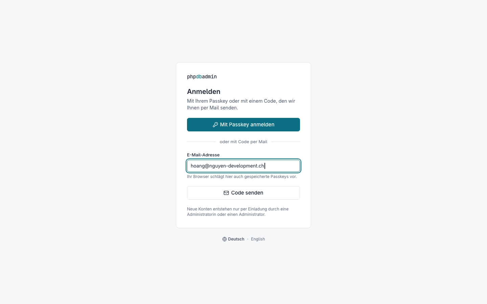

### 02 — Code eingeben

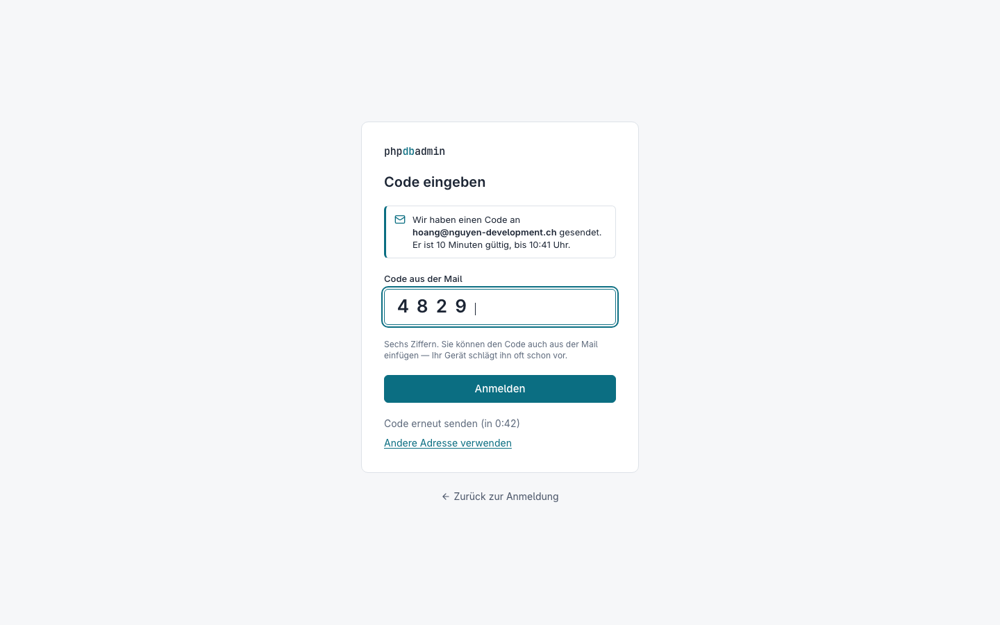

### 03 — Startseite: Verbindungen

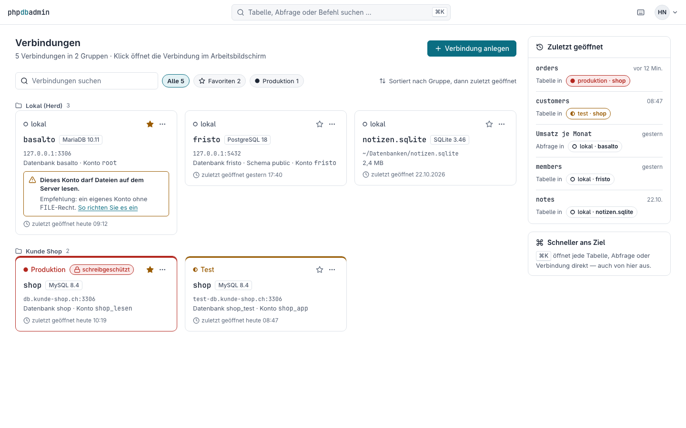

### 04 — Verbindung anlegen

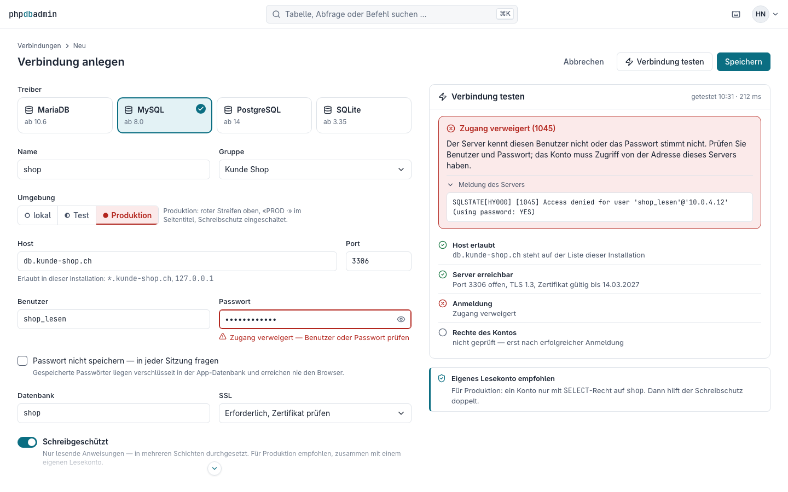

### 05 — Arbeitsbildschirm Daten

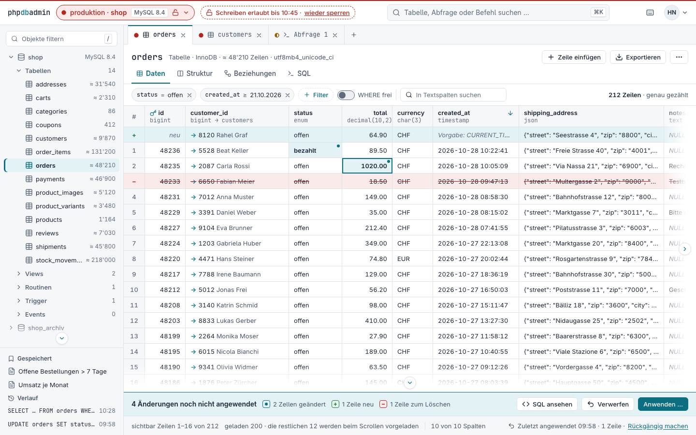

### 06 — SQL-Vorschau vor dem Anwenden

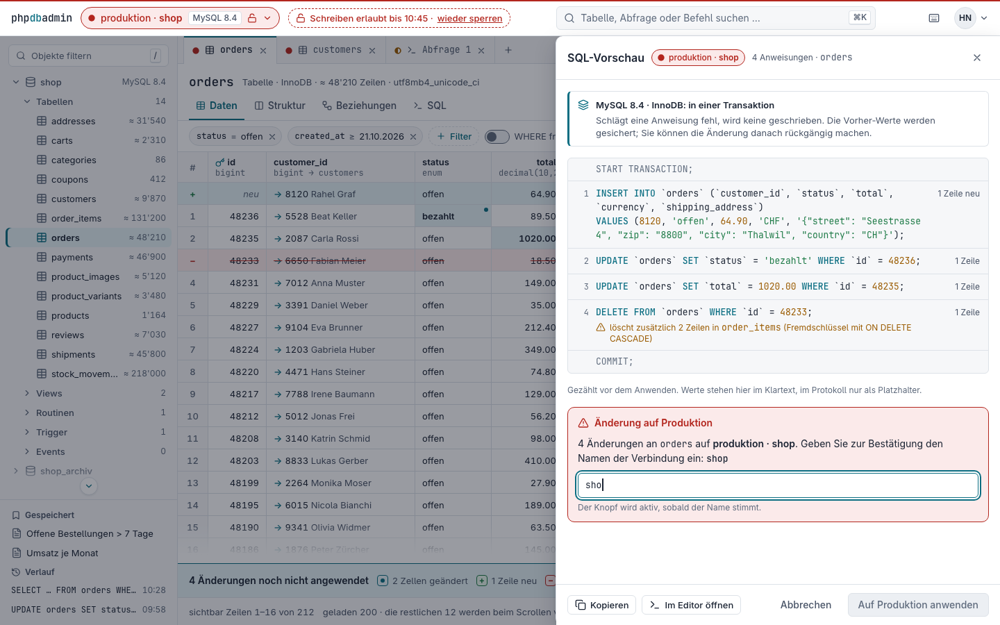

### 07 — Zeilen-Detail-Schublade

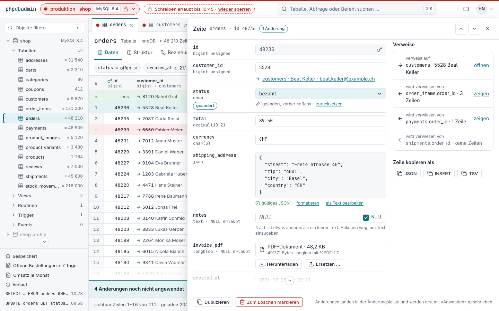

### 08 — Struktur einer Tabelle

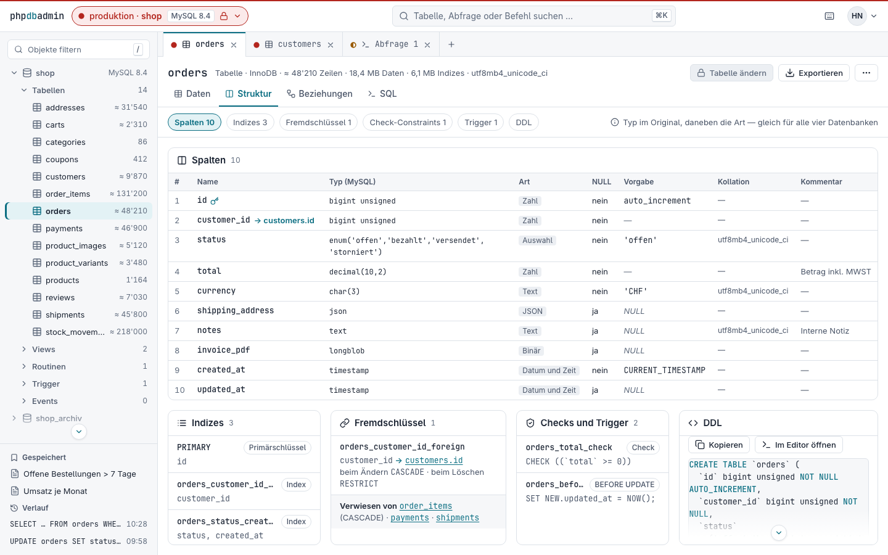

### 09 — Tabelle ändern mit Vorschau

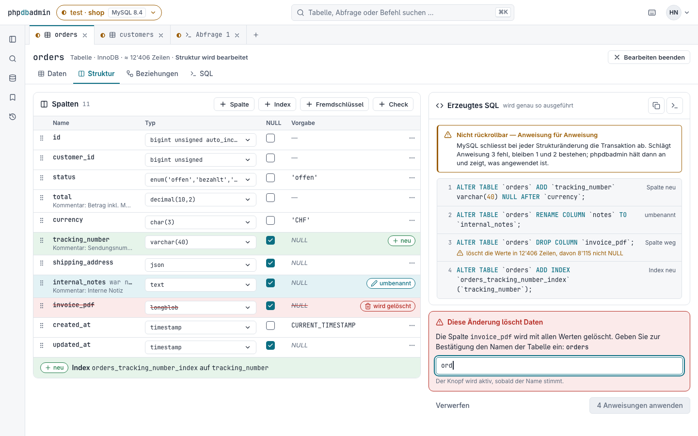

### 10 — SQL-Editor

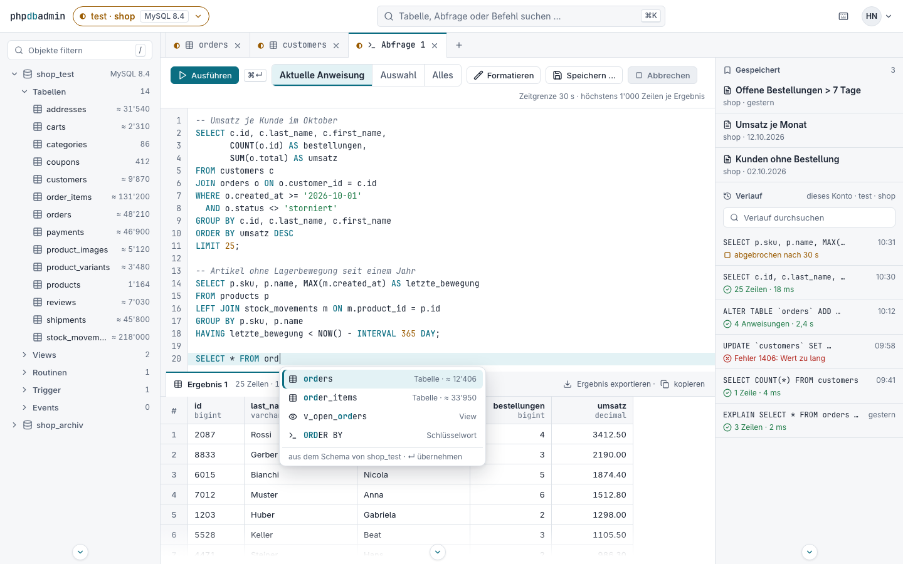

### 11 — Export und Import

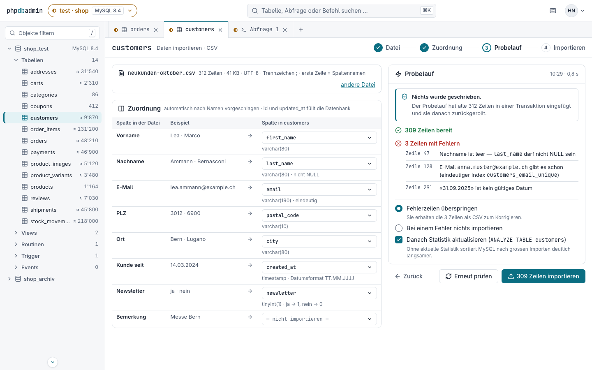

### 12 — Befehlspalette ⌘K

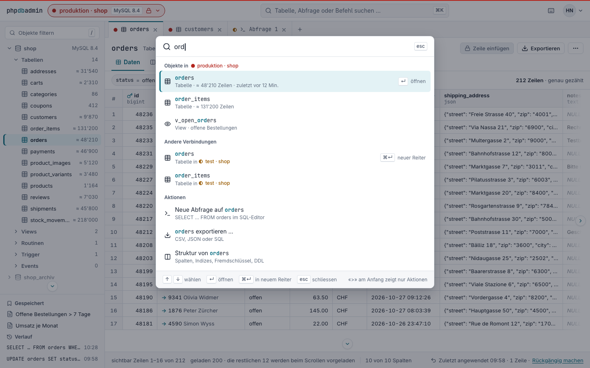

### 13 — Konto

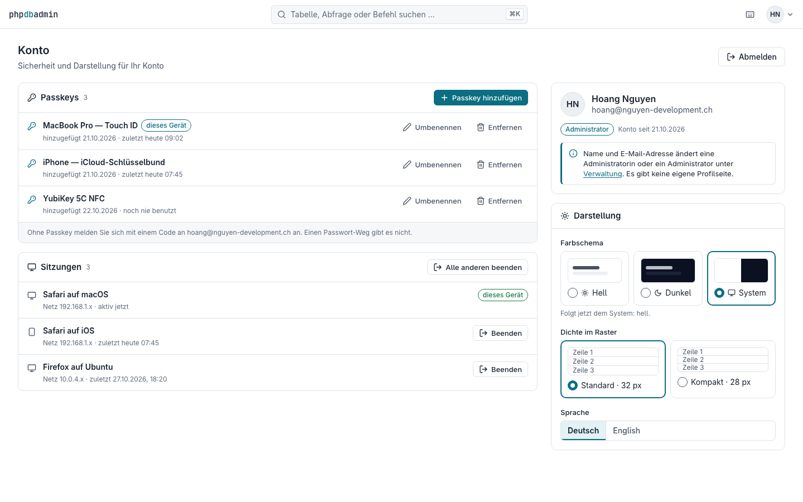

### 14 — Verwaltung

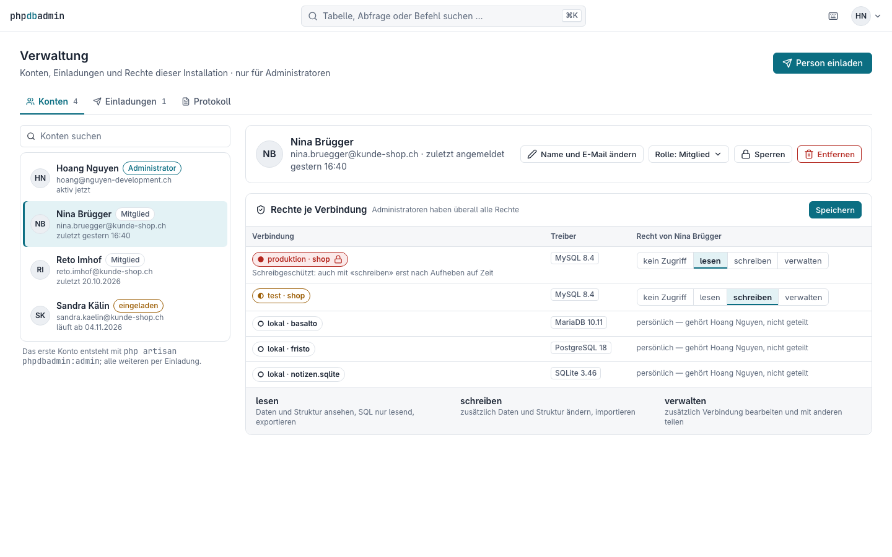

## Entscheide

Gestaltende Entscheide dieser Wireframes — gelten als Annahme bis zur Sichtprüfung mit TB 00, wie G-01 bis G-08 der Gestaltung; die Fragen F-1 bis F-6 sind entschieden.

| Nr. | Entscheid | Begründung |
|---|---|---|
| E-01 | **Passkey ist der Hauptknopf** der Anmeldung; der Code per Mail ist der zweite Weg darunter. Das E-Mail-Feld schlägt zugleich Passkeys vor (`autocomplete="username webauthn"`). | Im Alltag ist der Passkey ein Klick ohne Eingabe (Skizze Anmeldung, Weg 2); der Code ist für neue Geräte. Ein Akzent je Bereich (gestaltung § 2). |
| E-02 | **Code erneut senden** ist mit sichtbarer Wartezeit gesperrt («in 0:42»); bei «abgelaufen» bleibt der Code im Feld stehen, die Fehlerkarte nennt Gültigkeit und nächsten Schritt. | A-02 drosselt; eine Sperre ohne Zeitangabe wirkt wie ein Fehler. Fehler nennen Ursache und nächsten Schritt (§ 7). |
| E-03 | **Startseite als Karten in Gruppen**, Favoriten als Stern und Filter (keine eigene Favoritengruppe), rechts «Zuletzt geöffnet» statt Kennzahlen. | Kein Dashboard (A-04); eine Verbindung soll nur einmal erscheinen. «Zuletzt geöffnet» ist der kürzeste Weg zurück an die Arbeit. |
| E-04 | **Umgebung immer als Punkt und Wort**, Name im Muster «umgebung · name»; Produktion zusätzlich mit rotem Streifen und rotem Kartenrahmen, Test mit bernsteinfarbener Oberkante; die gewählte Umgebung im Formular trägt ihre eigene Farbe, nicht den Akzent. | Farbe nie allein (WCAG 1.4.1, § 2); die Umgebung muss überall gleich lesbar sein — im Chip, in Reitern, Listen und der Palette. |
| E-05 | **Schreibschutz auf Zeit aufheben:** «produktion · shop» ist schreibgeschützt (Bereich 3, 8, 11, 12). Für die Bereiche 5–7 hat Hoang ihn bis 10:45 aufgehoben — sichtbar als gestrichelter Chip «Schreiben erlaubt bis 10:45 · wieder sperren» und offenes Schloss; das Protokoll hält es mit Grund fest. | Sonst widersprechen sich «Produktion standardmässig schreibgeschützt» (V-04) und Bearbeiten auf Produktion (Skizze, Bereiche 5 und 6). Siehe Frage F-1. |
| E-06 | **«Auf Produktion anwenden» ist ein Gefahr-Knopf** und erst nach der Namenseingabe aktiv; auf dem Telefon steht die Namenseingabe angeheftet direkt über dem Knopf. Dieselbe Bestätigung mit dem Tabellennamen gilt für zerstörende Strukturänderungen auch ausserhalb von Produktion. | G-08; Gefahr ist für Produktion erlaubt (§ 2). Ohne Anheften wäre auf dem Telefon ein aktiver roter Knopf ohne sichtbare Bestätigung zu sehen. |
| E-07 | **SQL-Vorschau zählt je Anweisung** die betroffenen Zeilen und nennt Folgen über Fremdschlüssel («löscht zusätzlich 2 Zeilen in `order_items`»); Werte stehen in der Vorschau im Klartext, im Protokoll nur als `?`. | P-02 und P-04: nichts passiert ungesehen, betroffene Zeilen vorher zählen. B-04 verlangt maskierte Werte im Protokoll. |
| E-08 | **Werte im Raster roh** wie gespeichert (`1020.00`, `2026-10-28 10:22:41`), Zähler der Oberfläche mit Schweizer Apostroph (48'210) und «≈» bei Schätzungen. | Rohwerte lassen sich unverändert kopieren und bearbeiten; die Skizze zeigte «1 020.00» nur als Skizze. Geschätzt und genau müssen unterscheidbar sein (D-06). |
| E-09 | **Fremdschlüssel zeigt Schlüssel und Anzeigewert** des Ziels («→ 5528 Beat Keller»). | Eine nackte Zahl sagt nichts; der Pfeil bleibt der Klick zum Verweis (§ 3). Kostet eine Abfrage je Seite — siehe F-5. |
| E-10 | **Neue Zeilen stehen oben** im Raster, Zeilen zum Löschen bleiben bis «Anwenden» sichtbar; die Legende der Änderungsleiste trägt Zeichen (Punkt, +, −). | Was gesammelt ist, soll ohne Suchen sichtbar sein. Die Legende war zuerst nur Farbe auf gleich farbiger Leiste — unsichtbar. |
| E-11 | **Detail-Schublade breit** (900 px, zwei Spalten: Felder links, Verweise und «Zeile kopieren als» rechts); Zeiten in Europe/Zurich mit dem gespeicherten UTC-Wert darunter; NULL als eigenes Kästchen neben dem Feld. | Nur so passen JSON, Binärwert und Verweise ohne Fenster in der Schublade (§ 6, D-05). NULL und leer müssen unterscheidbar bleiben (§ 3). |
| E-12 | **Struktur zeigt den Typ im Original und eine gemeinsame Art** (Zahl, Text, JSON, Binär, Datum und Zeit, Auswahl); «Tabelle ändern» bleibt bei Schreibschutz sichtbar, aber gesperrt mit Schloss. | Feasibility F-1 und O-04: gleiche Begriffe für vier Datenbanken. Eine versteckte Funktion erklärt nicht, warum sie fehlt. |
| E-13 | **Tabelle ändern** klappt den Navigator zur Schiene ein und zeigt das erzeugte SQL laufend neben dem Formular, mit Hinweis je Treiber über den Anweisungen. | Formular und Vorschau brauchen zusammen die Breite; das SQL soll nie ein zusätzlicher Schritt sein (P-02, S-03). |
| E-14 | **Hervorhebung im Editor** mit Akzent (Schlüsselwörter), Erfolg (Zeichenketten), Warnung (Zahlen) und leise kursiv (Kommentare), nie Rot; **Ligaturen in JetBrains Mono aus**. | Rot ist Gefahr vorbehalten (§ 1). Mit Ligaturen erschienen `>=` als ≥ und `<>` als Raute — im SQL muss stehen, was getippt ist. |
| E-15 | **«Abgebrochen» ist eine Warnung** (Bernstein), kein Fehler, mit gemessener Zeit, `KILL QUERY` und drei nächsten Schritten. | Feasibility F-2: MySQL kehrt still zurück, die Anwendung muss es selbst sagen; ein Zeitlimit ist kein Fehler des Nutzers. |
| E-16 | **Import in vier Schritten** mit dem Probelauf als eigenem Schritt (in einer Transaktion, danach zurückgerollt); «Statistik aktualisieren» ist vorgewählt. | E-02 verlangt «Probelauf schreibt nichts»; E-06 aus der Feasibility (Sortieren ohne Statistik 100-mal langsamer). |
| E-17 | **Aufträge im Hintergrund** als schwebende Karte unten rechts (Telefon: oben im Blatt) mit Fortschritt, Abbrechen und Download bis zum Folgetag. | E-01: grosse Exporte im Hintergrund; Arbeiten soll weitergehen. |
| E-18 | **Befehlspalette** gruppiert nach aktueller Verbindung, anderen Verbindungen (mit Umgebung) und Aktionen; «>» am Anfang zeigt nur Aktionen. | O-02; eine Tabelle gleichen Namens auf Test und Produktion muss in der Palette unterscheidbar sein. |
| E-19 | **Konto ist eine Seite** mit Sicherheit und Darstellung; das Kontomenü führt zu Sicherheit, Darstellung, Verwaltung (nur Administratoren) und Abmelden; Name und E-Mail stehen nur lesend mit Hinweis auf die Verwaltung. | A-05: keine Profilseite. Die Farbschema-Wahl «System» ist Vorgabe (G-05). |
| E-20 | **Rechte als vierstufiger Umschalter** je Verbindung (kein Zugriff, lesen, schreiben, verwalten) mit Erklärung darunter; persönliche Verbindungen erscheinen, sind aber nicht teilbar. | A-07, V-09. «Schreiben» auf einer schreibgeschützten Verbindung wirkt erst nach Aufheben auf Zeit — das steht direkt an der Zeile. |
| E-21 | **Mobil:** Raster als Kartenliste (id im Kopf, dann `customer_id`, `status`, `total`), Änderungsleiste unten fest, Navigator als Schublade von links mit Verbindungswechsel oben, Vorschau und Export als Blatt von unten, Palette als ganze Seite. | Gestaltung § 8 und G-07; Bearbeiten bleibt möglich, Struktur ändern ist ausdrücklich «für den Desktop ausgelegt». |
| E-22 | **Fett ist 600**, nur die Zeilenzeichen «+» und «−» und Treffer in der Palette sind 700. Die Palette kommt ausschliesslich aus `kontraste.py`; abgeleitet sind nur Schleier und Schatten. | Ruhige Oberfläche (§ 1); eine Quelle der Farben, damit die gerechneten Kontraste gelten. |

## Fragen an Hoang — entschieden 28.10.2026

Alle sechs wie empfohlen entschieden (Hoang, interaktiv: F-1 als neue Anforderung **V-11**, F-2 bis F-6 «wie empfohlen»). Dazu entschied Hoang, dass das Raster **endlos scrollt** (ADR-006) — die Fusszeile des Arbeitsbildschirms zeigt seither nur die Position («sichtbar Zeilen 1–16 von 212 · geladen 200»), keine Seitenknöpfe mehr.

| Nr. | Frage | Empfehlung = Entscheid |
|---|---|---|
| F-1 | Wie schreibt man auf eine schreibgeschützte Produktion? (a) Schreibschutz **auf Zeit aufheben** wie gezeigt (E-05), (b) nur über eine zweite, nicht geschützte Verbindung, (c) gar nicht. | **(a)** mit 15 Minuten, Pflichtgrund, nur mit Recht «schreiben», im Protokoll — als neue Anforderung V-11 in CR-001 aufnehmen. |
| F-2 | Soll «Anwenden» auf Produktion **rot** (Gefahr) sein oder im Akzent bleiben wie überall sonst? | **Rot** — die Gestaltung erlaubt Gefahr für die Umgebung Produktion, und die Namenseingabe davor macht den Schritt bewusst. |
| F-3 | Detail-Schublade **breit (900 px)** mit allen Feldern und Verweisen, oder **schmal (560 px)** mit langen Werten weiter unten? | **Breit**, mit ziehbarer und gemerkter Breite; auf dem Telefon ohnehin ganze Seite. |
| F-4 | **Neue Zeilen oben** angeheftet bis «Anwenden», oder an der Stelle, an der sie nach Sortierung stehen würden? | **Oben** — sonst verschwindet eine neue Zeile bei grossen Tabellen auf einer anderen Seite. |
| F-5 | **Anzeigewert am Fremdschlüssel** («→ 5528 Beat Keller») — eine zusätzliche Abfrage je Seite. Immer, abschaltbar, oder nie? | **Standardmässig an** (erste Textspalte des Ziels, nur für die sichtbare Seite), je Tabelle abschaltbar. |
| F-6 | Soll die Startseite die **Verbindungsübersicht** bleiben oder direkt die **zuletzt geöffnete Verbindung** zeigen? | **Übersicht** mit «Zuletzt geöffnet» rechts (wie gezeigt); eine Einstellung «Startseite» frühestens in Stufe 4. |

## Grenzen der Wireframes

- **Nicht gezeichnet:** Ansicht «Beziehungen» (S-07, Stufe 3), Reiter «Einladungen» und der Einladungs-Dialog, Leer- und Ladezustände des Rasters (O-09; gezeigt sind nur Fehler- und Abbruchzustände), Import auf dem Telefon, Protokoll auf dem Telefon, Tabelle anlegen (S-02 nutzt das Formular aus Bereich 9).
- **Symbole** sind Lucide-Formen, von Hand als SVG-Pfade nachgezeichnet; einzelne weichen leicht vom Original ab.
- **Zusatzbild 09 PostgreSQL** nimmt eine angenommene Kopie «lokal · shop» auf PostgreSQL, damit dieselbe Tabelle auf zwei Treibern nebeneinander steht (O-04); sie gehört nicht zu den fünf Beispielverbindungen.
- Statische Seiten: Scrollen, Hover und Tastatur sind als Zustand gezeichnet (Verlaufskante mit Chevron, Fokusrahmen, Cursor), nicht bedienbar.
