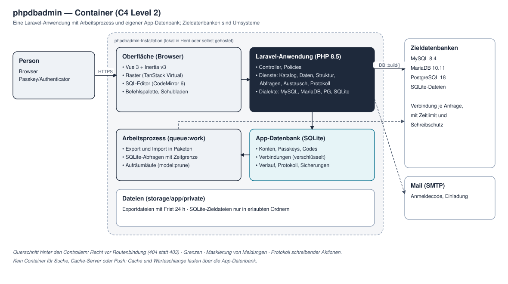
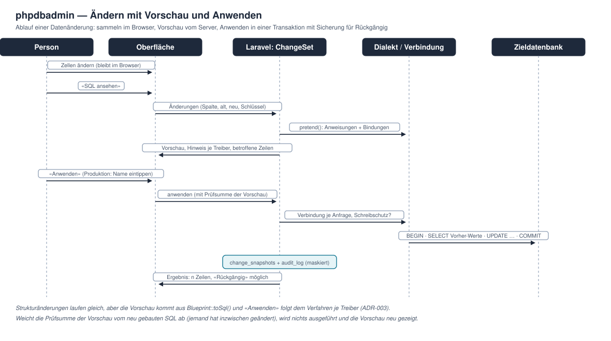
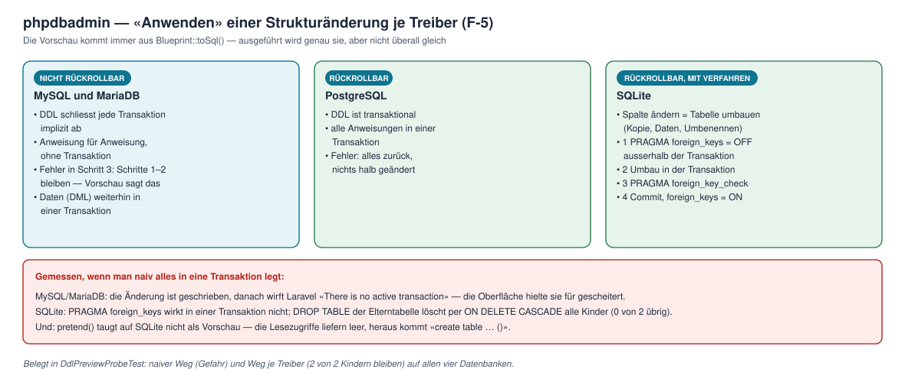

# Solution-Architektur — phpdbadmin

**Stand:** 28.10.2026 · v1.0 (Foundation). Eingang: [CR-001](../00-change_request/CR-001-phpdbadmin.md) Fassung 3, [Feasibility](../02-feasibility/feasibility.md) v1.0, [Terms of Reference](../01-pre-project/terms-of-reference.md) v1.0. Die Entscheide A-01 bis A-14 in § 15 sind als ADR-001 bis ADR-011 ausformuliert ([04-evolutionary-development/adr](../04-evolutionary-development/README.md#architekturentscheide)).

## 1. Überblick

phpdbadmin ist **eine Laravel-Anwendung** mit einer Oberfläche aus Inertia-Seiten, einem Arbeitsprozess für die Warteschlange und einer eigenen App-Datenbank. Die verwalteten Datenbanken sind Umsysteme: Die Anwendung baut je Anfrage eine Verbindung aus den gespeicherten Angaben, setzt Grenzen und gibt sie nach der Anfrage wieder frei. Was alle vier Treiber gleich können, macht Laravel; was sie unterscheidet, macht die **Dialekt-Schicht** (ADR-001).

## 2. Was die Plattform vorgibt

| Vorgabe | Folge |
|---|---|
| **PHP 8.5** | `Pdo\Sqlite::setAuthorizer()` gibt es erst ab 8.5 (geprüft: 8.4.27 nein, 8.5.12 ja) — Mindestversion des Produkts (ADR-011); `composer.json` von `^8.3` auf `^8.5` |
| Laravel 13.39, Inertia v3, Vue 3, Tailwind 4, Wayfinder | wie installiert |
| Betrieb lokal (Herd) und selbst gehostet (R-11) | keine Mandanten, keine SaaS-Grenzen; eine Installation = eine App-Datenbank |
| Zieldatenbanken liegen oft in internen Netzen | phpdbadmin läuft neben ihnen; erlaubte Hosts sind Pflicht (V-05) |
| PHP-Anfragen sind synchron, PHP-FPM bearbeitet mehrere gleichzeitig | Abbrechen läuft als zweite Anfrage; Sitzungen ohne Sperre (Datenbank-Sitzungstreiber) |

## 3. Schichten und Verzeichnisse

| Schicht | Ort (Vorschlag) | Inhalt |
|---|---|---|
| Oberfläche | `resources/js/pages/{connections,workspace,account,admin,auth}`, `resources/js/components/{grid,editor,navigator,…}` | Inertia-Seiten und Bausteine aus der [Gestaltung](gestaltung.md) § 6; SQL-Editor und Raster als eigene Chunks |
| HTTP | `app/Http/Controllers/{Connections,Workspace,Account,Admin,Auth}`, `app/Http/Middleware/ResolveTargetConnection` | dünne Controller, Form Requests, Policies |
| Dienste | `app/Services/{Catalog,DataBrowser,ChangeSet,SchemaEditor,QueryRunner,Transfer,Audit}` | die eigentliche Arbeit, treiberunabhängig |
| Dialekte | `app/Dialects/{Dialect,MySqlDialect,MariaDbDialect,PostgresDialect,SqliteDialect}` | Vertrag und vier Umsetzungen |
| Zielverbindungen | `app/Connections/{ConnectionFactory,HostPolicy,ReadOnlyGuard,AccountInspector}` | Verbindung bauen, Hosts prüfen, Schreibschutz, Kontorechte (V-10) |
| Modelle | `app/Models` | Tabellen aus dem [Datenmodell](datenmodell.md) |
| Hintergrund | `app/Jobs/{RunExport,RunImport,RunSqliteQuery}` | Warteschlange `database` |

Neue Ordner liegen **unter `app/`**, kein neuer Basisordner im Repo (Projektregel).

## 4. Anfrageverlauf

1. **Anmeldung** (Sitzung) → **`ResolveTargetConnection`** lädt die Verbindung aus der Adresse und prüft das Recht des Kontos **vor** der Routenbindung — eine fremde Verbindung ist 404, nicht 403 (T-16).
2. Der Controller ruft einen **Dienst**; der Dienst holt über die **`ConnectionFactory`** eine Verbindung (`DB::build()` mit Zeitzone UTC, Zeitlimit, Schreibschutz) und den passenden **Dialekt**.
3. Der Dienst arbeitet über Laravel (Query Builder, Schema-Introspektion, `Blueprint`) und über den Dialekt.
4. **Querschnitt** hinter den Controllern, nicht in jedem einzeln: Grenzen (Zeit, Zeilen), Maskierung von Meldungen, Protokoll schreibender Aktionen.
5. Die Antwort trägt nie Zugangsdaten (Test über die ausgelieferte Antwort, T-03); die Verbindung wird nach der Anfrage getrennt (`DB::purge`).

## 5. Zielverbindungen

- **Bauen:** Konfiguration aus `connections` (Passwort entschlüsselt erst hier), `DB::build()` je Anfrage; Name aus Verbindung und Konto, damit sich zwei Konten nie eine Verbindung teilen.
- **Sitzungswerte aus der Konfiguration:** `timezone` (`+00:00` bzw. `UTC`) — belegt in F-2.
- **Zeitlimit je Anweisung:** MySQL `max_execution_time` (gilt nur für SELECT), MariaDB `max_statement_time`, PostgreSQL `statement_timeout`; SQLite hat keines → Abfragen aus dem SQL-Editor laufen in einem **Arbeitsprozess** (`RunSqliteQuery`) mit harter Zeitgrenze (Q-09).
- **Erlaubte Hosts:** `PHPDBADMIN_ALLOWED_HOSTS` (Namen, Adressen, Netze) und `PHPDBADMIN_SQLITE_PATHS`; der Host wird einmal aufgelöst und die geprüfte Adresse verbunden (gegen DNS-Rebinding), SQLite-Pfade mit `realpath()` (gegen `..` und Symlinks) — T-05, T-08.
- **Kontorechte (V-10):** `AccountInspector` liest beim Testen und beim ersten Öffnen Superuser-Status (PostgreSQL `rolsuper`), `FILE`-Recht und `secure_file_priv` (MySQL/MariaDB) und speichert Warnungen in `account_warnings`.
- **Verbindungsfehler** je Treiber in Klartext: MySQL/MariaDB nach Code (2002, 1045, 1049), PostgreSQL nach Meldungstext (alle `08006`) — F-2.

## 6. Schreibschutz

Belegt in F-7 gegen 5–12 Ausbruchsversuche je Treiber (ADR-004):

| Schicht | MySQL / MariaDB | PostgreSQL | SQLite |
|---|---|---|---|
| Konto | Lesekonto empfohlen (Hinweis in der Oberfläche) | dito | — |
| Je Anweisung | `SET SESSION TRANSACTION READ ONLY` + Transaktion, immer zurückrollen | Transaktion + `SET TRANSACTION READ ONLY`, zurückrollen | Datei mit `Pdo\Sqlite::OPEN_READONLY` geöffnet |
| Eingabe | eine Anweisung je Aufruf, vorbereitet (`ATTR_EMULATE_PREPARES = false`), nie `unprepared()` | dito | dito, dazu Authorizer (`ATTACH` nur im erlaubten Ordner) |

## 7. Katalog

`Catalog` liest über Laravel (`getSchemas`, `getTables`, `getViews`, `getColumns`, `getIndexes`, `getForeignKeys`) und ergänzt über den Dialekt: Check-Constraints, Trigger, Routinen, eigene Typen (nur PostgreSQL, Array-Typen ausgeblendet), Sequenzen, Events. **Das Schema wird immer ausdrücklich übergeben** — MariaDB liefert sonst alle Datenbanken des Servers (F-1, F-3). Ergebnisse werden je Anfrage berechnet und höchstens 60 Sekunden zwischengespeichert; «Neu laden» leert den Speicher. Typnamen erscheinen im Original und mit einem gemeinsamen Oberbegriff (Text, Zahl, Datum/Zeit, JSON, Binär, Wahrheitswert, Aufzählung).

## 8. Daten lesen und bearbeiten

- **Blättern über den Schlüssel** (`WHERE (sort, id) > (…) ORDER BY … LIMIT 200`), `OFFSET` nur ohne Primärschlüssel (F-3: 0,1–0,6 ms gegen 18–232 ms). Die nächste Seite wird vorgeladen.
- **Filter** als Struktur (Spalte, Operator, Wert) → Query Builder mit Bindungen; das freie `WHERE` läuft durch den `QueryRunner` mit allen Grenzen.
- **Zählen:** genau bis zu einer Schwelle, sonst Schätzung aus der Statistik (`TABLE_ROWS`, `reltuples`, `sqlite_stat1`), «genau zählen» auf Wunsch.
- **`ChangeSet`** sammelt Änderungen im Browser; der Server baut daraus Anweisungen, zeigt sie über `pretend()` mit Bindungen als Vorschau (belegt für DML in F-5) und wendet sie in **einer Transaktion** an. Vorher liest er die betroffenen Zeilen und schreibt sie nach `change_snapshots` (Rückgängig, D-09).
- **Tabellen ohne Primärschlüssel:** Bearbeiten nur, wenn die Zeile über alle Spalten eindeutig ist; sonst gesperrt mit Erklärung (D-07).

## 9. Struktur ändern

Vorschau **immer** aus `Blueprint::toSql()`, nie aus `pretend()` (auf SQLite kaputt, F-5). **Anwenden je Treiber** (ADR-003):

| Treiber | Verfahren | Was die Vorschau sagt |
|---|---|---|
| MySQL, MariaDB | Anweisung für Anweisung ohne Transaktion; bei Fehler stoppen und den Stand melden | «Nicht rückrollbar: bei einem Fehler bleiben die vorherigen Schritte bestehen.» |
| PostgreSQL | alle Anweisungen in einer Transaktion | «Wird in einer Transaktion ausgeführt.» |
| SQLite | `PRAGMA foreign_keys = OFF` ausserhalb, Umbau in der Transaktion, `PRAGMA foreign_key_check`, Commit, `ON` | «Tabelle wird umgebaut (Kopie); in einer Transaktion.» |

Nach eigenen Importen und auf Knopfdruck aktualisiert der Dienst die Statistik (`ANALYZE`, E-06) — ohne sie sortieren MySQL und MariaDB über einen Index hundertmal langsamer (F-3).

## 10. SQL-Editor

- **Aufteilen in Anweisungen** auf dem Server mit einem Zerleger je Dialekt, der Zeichenketten, Kommentare, `$$`-Blöcke (PostgreSQL) und `BEGIN … END` in Routinen kennt; jede Anweisung wird einzeln vorbereitet und ausgeführt. Der Zerleger ist das grösste technische Risiko des Editors (Probe zu Beginn von TB 03).
- **Gefährliche Anweisungen** (DROP, TRUNCATE, DELETE/UPDATE ohne WHERE) erkennt derselbe Zerleger; sie brauchen die Bestätigung (Q-07).
- **Zeilengrenze ohne Speicherexplosion** (F-8): MySQL/MariaDB ungepuffert lesen und nach N Zeilen mit `KILL QUERY` beenden; PostgreSQL bei SELECT über einen Server-Cursor (`DECLARE … CURSOR` in der Transaktion, `FETCH N`), weil libpq sonst das ganze Ergebnis hält; SQLite streamt von selbst.
- **Abbrechen:** Der Lauf merkt sich Sitzungskennung (`CONNECTION_ID()`, `pg_backend_pid()`) unter einer Laufkennung im Cache; «Abbrechen» ist eine zweite Anfrage, die `KILL QUERY` bzw. `pg_cancel_backend()` über eine eigene Verbindung schickt und einen Merker setzt. Weil MySQL still abbricht (Ergebnis `1`, kein Fehler), entscheidet der Merker über die Anzeige «abgebrochen», nicht der Fehlercode (Q-02). SQLite: Arbeitsprozess beenden.
- **Editor im Browser:** CodeMirror 6 mit `@codemirror/lang-sql`, Dialekt und Schema aus dem Katalog, als eigener Chunk (425 KB, 138 KB gzip) nur auf dem SQL-Reiter (ADR-005).

## 11. Export und Import

Export in Paketen über den Schlüssel (`lazyById(5000)`, gemessen 3 MB je Million Zeilen) im Hintergrund (`RunExport`), Datei mit Frist; ohne laufenden Worker synchron bis zu einer Grenze (B-07). Import: CSV mit Spaltenzuordnung, **Probelauf** in einer Transaktion, die zurückgerollt wird; danach echter Lauf in Paketen zu 1'000 (gemessen 143–502 ms je 100'000 Zeilen) und `ANALYZE` (ADR-007).

## 12. Anmeldung und Konten

Fortify nur noch für die Passkey-Zeremonie; seit TB 00 registriert Fortify **keine eigenen Routen** (`Fortify::ignoreRoutes()`), `routes/auth.php` trägt nur die Passkey-Wege der Bibliothek — einen Passwort-Endpunkt gibt es damit gar nicht (strenger als das ursprünglich geplante `authenticateUsing()`, das nur abgelehnt hätte). Die Passwortbestätigung (`password.confirm`) wird durch Bestätigung per Passkey oder per Code an die eigene Adresse ersetzt; jede Anmeldung gilt zugleich als Bestätigung (F-6, ADR-008). Code-Anmeldung als eigener Controller nach dem Muster von Basalto: Code mit HMAC gespeichert, benannte Limiter je Adresse und IP, gleiche Antwort für unbekannte Adressen, Sitzung neu. Erstes Konto per `php artisan phpdbadmin:install`, weitere per Einladung. Rollen `admin`/`member`, Rechte je Verbindung über Policies.

## 13. Protokoll und Maskierung

`Audit` schreibt jede schreibende Aktion mit Anweisung, Ziel und betroffenen Zeilen. **Fehlermeldungen werden maskiert**, bevor sie angezeigt, protokolliert oder gemeldet werden: Laravel setzt gebundene Werte in die Meldung ein (F-7) — der `Audit`-Dienst und ein Exception-Reporter ersetzen sie durch Platzhalter. Das Laravel-Log bekommt keine Werte aus Zieldatenbanken.

## 14. Qualitätssicherung

- **Tests auf vier Treibern:** App-Datenbank in Tests SQLite im Speicher; Tests gegen Zieldatenbanken laufen gegen die Herd-Dienste (MySQL 8.4 :3307, MariaDB 10.11 :3306, PostgreSQL 18 :5432, SQLite) und überspringen einen nicht erreichbaren Server ausdrücklich — aus den Proben der Feasibility werden **Vertragstests** des Dialekts.
- **Pipeline sparsam** (globale Regel): je Push ein Auftrag (Pint, Larastan Level 7, `vp check`, `vue-tsc`, Tests auf SQLite); die Matrix mit MySQL, MariaDB und PostgreSQL als Service-Container wöchentlich und von Hand; `paths-ignore` für Doku.
- **Durchlauf im Browser** je Timebox gegen die Wireframes, bei 1440, 768 und 375 px; Sicherheitsprüfung nach OWASP vor v1.0.

## 15. Entscheide

| Nr. | Entscheid | ADR |
|---|---|---|
| A-01 | Dialekt-Schicht: ein Vertrag, vier Umsetzungen; Laravel zuerst, Schema immer ausdrücklich | ADR-001 |
| A-02 | Zielverbindungen je Anfrage über `DB::build()`, Sitzungswerte aus der Konfiguration | ADR-002 |
| A-03 | Vorschau aus `toSql()`; Anwenden je Treiber | ADR-003 |
| A-04 | Schreibschutz in drei Schichten | ADR-004 |
| A-05 | SQL-Editor CodeMirror 6, eigener Chunk | ADR-005 |
| A-06 | Raster mit `@tanstack/vue-virtual`, Blättern über den Schlüssel | ADR-006 |
| A-07 | Export und Import in Paketen im Hintergrund, Statistik nach Import | ADR-007 |
| A-08 | Anmeldung ohne Passwort: Fortify nur für Passkeys, eigener Code-Login | ADR-008 |
| A-09 | App-Datenbank SQLite als Vorgabe | ADR-009 |
| A-10 | Lizenz MIT, Abhängigkeiten MIT-verträglich | ADR-010 |
| A-11 | PHP 8.5 als Mindestversion | ADR-011 |
| A-12 | Anweisungen auf dem Server zerlegen, eine je Aufruf | ADR-004 |
| A-13 | Zeilengrenze je Treiber: ungepuffert + `KILL QUERY`, Server-Cursor, Streaming | ADR-002 |
| A-14 | Abbruch über einen eigenen Merker, nicht über den Fehlercode | ADR-002 |

## 16. Offene Punkte

- Zerleger für SQL-Anweisungen: eigener Bau oder Paket — Probe zu Beginn von TB 03, Lizenz MIT-verträglich.
- SSH-Tunnel (V-08, Stufe 4): PHP-Erweiterung `ssh2` oder ein Hilfsprozess `ssh -L` — Entscheid in TB 11.
- Gemeinsamer Oberbegriff der Typen: Liste je Dialekt in TB 01 festlegen.
