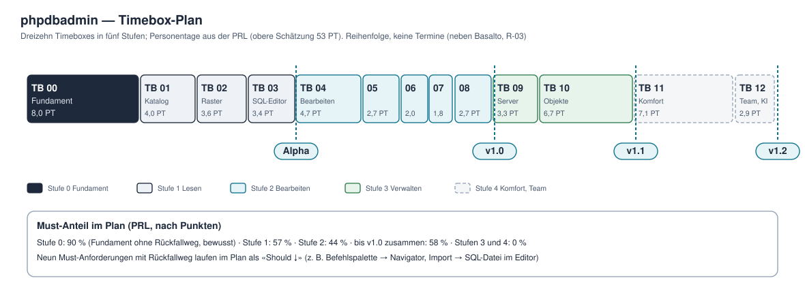

# Timebox-Plan — phpdbadmin

**Stand:** 28.10.2026 · v1.0 (Foundation). Zuordnung der Anforderungen und Punkte aus der [PRL](prl.md) (erzeugt), Personentage anteilig aus dem Budget je Stufe (obere Schätzung 53 PT). Wireframe-Bereiche siehe [mockups](mockups/README.md).



## 1. Die dreizehn Timeboxes

| TB | Inhalt | Anforderungen (Must im Plan fett) | Wireframes | PT | Braucht |
|---|---|---|---|---|---|
| **00** | **Fundament:** Starter-Kit bereinigen (Passwort, Dashboard, Profil weg), Code und Passkey, App-Datenbank, Verbindungen anlegen und testen, erlaubte Hosts, Dialekt-Schicht, Tests auf vier Datenbanken | **A-01–A-05**, A-06 ↓, A-09, **V-01–V-03, V-05**, **B-01–B-03, B-06, B-08** | 1–4, 13 | ~8,0 | Foundation ✓ |
| 01 | Katalog und Navigator, Strukturansicht, Umgebung und Schreibschutz, Kontowarnung | **O-01, O-04, S-01, V-04, N-06**, V-06, V-10, O-06 ↓, N-04 ↓ | 3, 5, 8 | ~4,0 | TB 00 |
| 02 | Datenraster und Filter, Fremdschlüssel, Zählen, Reiter, Zustände | **D-01, D-02, N-01**, D-03, D-06, O-03, O-05, O-09 ↓ | 5, 7 | ~3,6 | TB 01 |
| 03 | SQL-Editor, Grenzen, Abbrechen, Verlauf, SQLite-Arbeitsprozess, Befehlspalette → **Alpha** | **Q-01–Q-03**, Q-04, Q-09, O-02 ↓ | 10, 12 | ~3,4 | TB 01 |
| 04 | Bearbeiten mit Vorschau, Rückgängig, Bestätigung gefährlicher Anweisungen | **D-04, N-03, Q-07**, D-09, E-05, V-11, D-05 ↓, D-07 ↓ | 5, 6, 7 | ~4,7 | TB 02, TB 03 |
| 05 | Struktur ändern: anlegen, ändern, je Treiber anwenden | **S-02, S-03**, S-05, S-04 ↓ | 9 | ~2,7 | TB 01, TB 04 |
| 06 | Export und Import im Hintergrund, Statistik | **E-01**, E-06, B-07, E-02 ↓ | 11 | ~2,0 | TB 02 |
| 07 | Konten, Rechte je Verbindung, Teilen, Protokoll mit Maskierung | **B-04**, A-07, V-09 | 14 | ~1,8 | TB 00, TB 04 |
| 08 | Sicherheitsprüfung, Barrierefreiheit, Mobil, Hilfe, Installation → **v1.0** | **N-02**, O-07, O-08, N-05, B-05 | alle | ~2,7 | TB 04–07 |
| 09 | Server-Verwaltung: Übersicht, Prozesse, Variablen, Benutzer und Rechte, Wartung | W-01–W-05 | — (in TB 09 entworfen) | ~3,3 | v1.0 |
| 10 | Views, Routinen, Trigger, Beziehungsdiagramm, EXPLAIN, Ergebnisse bearbeiten, Suche, Sicherung, Excel → **v1.1** | S-06, S-07, Q-05, Q-06, D-08, E-03, E-04 | — | ~6,7 | v1.0 |
| 11 | Schemavergleich, Laravel-Migration, Herd-Erkennung, SSH-Tunnel | S-08, S-09, V-07, V-08 | — | ~7,1 | v1.1 |
| 12 | Sitzungen verwalten, SQL-Hilfe mit KI → **v1.2** | A-08, Q-08 | — | ~2,9 | v1.1 |

↓ = im CR Must, im Plan Should mit Rückfallweg (PRL § 2).

## 2. TB 00 in Scheiben

| # | Scheibe | Inhalt | Anforderungen |
|---|---|---|---|
| 1 | Starter-Kit bereinigen | Passwort-Anmeldung, Registrierung, Passwort-Reset und -Bestätigung, Zwei-Faktor, E-Mail-Bestätigung, Dashboard, Profil, «Konto löschen» entfernt; Fortify nur für Passkeys, `authenticateUsing()` lehnt ab; Spalten und Tabelle für Passwörter weg; Startseite = Verbindungsübersicht (leer); Kontomenü mit Sicherheit und Darstellung; Tests des Starter-Kits durch eigene ersetzt; `APP_URL=https://phpdbadmin.test`, `APP_LOCALE=de` | A-01, A-04, A-05, B-01 |
| 2 | Anmeldung | Code per Mail (HMAC, 10 Minuten, einmalig, benannte Limiter, gleiche Antwort für Unbekannte), Passkey anmelden und verwalten, `phpdbadmin:install` für das erste Konto, Einladung mit Ablauf, Anmeldungen im Protokoll; Software-Authenticator für Tests nach dem Muster von Basalto | A-02, A-03, A-06, A-09 |
| 3 | Verbindungen | Migrationen nach dem [Datenmodell](datenmodell.md), Verbindung anlegen und bearbeiten für vier Treiber, «Verbindung testen» mit Klartext je Treiber, Zugangsdaten verschlüsselt und nie im Browser, erlaubte Hosts und SQLite-Ordner (`realpath`, einmal auflösen) | V-01, V-02, V-03, V-05, B-06 |
| 4 | Dialekt-Schicht | Vertrag und vier Umsetzungen (Katalog-Grundlagen, Zeitlimits, Schreibschutz-Wächter, Fehlerzuordnung, Kontorechte); Proben aus `tests/Feature/Feasibility` zu Vertragstests umgebaut; `composer.json` auf PHP `^8.5` (ADR-011) | B-02 |
| 5 | Qualität und Abnahme | lokales Skript für die vier Treiber, Workflow sparsam (ein Auftrag je Push, Matrix wöchentlich), Probe-Seiten übernehmen oder entfernen, Durchlauf im Browser gegen die Wireframe-Bereiche 1–4 und 13 bei 1440 und 375 px, Protokoll | B-03, B-08 |

## 3. Meilensteine und Abnahme

| Meilenstein | nach | Abnahme |
|---|---|---|
| **Alpha** | TB 03 | Hoang nutzt phpdbadmin eine Woche zum Nachsehen statt phpMyAdmin/TablePlus; Vertragstests auf vier Treibern grün; Navigator mit 1'000 Tabellen und Raster mit 1 Mio. Zeilen im Browser flüssig |
| **v1.0** | TB 08 | Kernabläufe (Bearbeiten, Struktur, Export, Import) auf vier Treibern getestet, inklusive Elterntabelle mit Kindern; White-Box-Sicherheitsprüfung nach OWASP ohne hohen Befund; axe ohne Befund in den Kernbildschirmen; Installation in einem leeren Ordner unter 15 Minuten |
| **v1.1** | TB 10 | Server-Verwaltung auf drei Server-Treibern getestet; Sicherung und Wiederherstellung mit den Server-Werkzeugen |
| **v1.2** | TB 12 | Schemavergleich und Migration gegenseitig zwischen zwei Treibern; KI-Hilfe nur mit Schema (Test mit Attrappe) |

## 4. Reihenfolge und Abhängigkeiten

TB 00 trägt alles. TB 02 (Raster) und TB 03 (Editor) hängen beide nur an TB 01 und können in beliebiger Reihenfolge folgen; Bearbeiten (TB 04) braucht beide, weil die Vorschau im Editor geöffnet werden kann. Rechte und Protokoll (TB 07) kommen nach dem Bearbeiten, weil erst dann schreibende Aktionen protokolliert werden. Die Sicherheitsprüfung (TB 08) steht vor v1.0, nicht danach. phpdbadmin läuft neben Basalto (R-03): eine Timebox wird angefangen und fertig gemacht, nicht unterbrochen.

## 5. Was aus der Feasibility übernommen wird

| Aus | Wird |
|---|---|
| `tests/Feature/Feasibility/ProbeTestCase` | Basis der Vertragstests (Verbindungen zu den Herd-Diensten, ausdrückliches Überspringen) |
| `CatalogProbeTest` | Vertragstests des Katalogs (TB 00/01) |
| `DdlPreviewProbeTest` | Abnahmetests von S-02, S-03, N-03 (TB 05) |
| `ConnectionProbeTest` | Vertragstests für Zeitlimit, Abbrechen, Fehlerzuordnung (TB 00/03) |
| `SecurityProbeTest` | Abnahmetests von V-04, V-05, V-10, B-04 (TB 00/01/07) |
| `LargeTableProbeTest` | Leistungsprobe N-01, E-01 (bleibt hinter `PROBE_GROSS=1`) |
| `routes/probe.php`, `pages/probe/*` | Raster und Editor als Ausgangspunkt für TB 02/03, danach entfernt |

## 6. Protokoll je Timebox (Vorlage)

```
# TB nn — Titel
## Ziel (ein Satz)
## Umfang: Anforderungen aus der PRL (Must / Should ↓), Wireframe-Bereiche
## Abnahmekriterien (aus CR-001 § 4, konkret je Anforderung)
## Abweichungen von den Wireframes (benannt, Wireframes nachgezogen)
## Tests (neue und geänderte; je Treiber; zweites Konto für Rechte)
## Commits
## Gelernt (Lektionen in den Vault, Projektspezifisches ins Memory)
```
