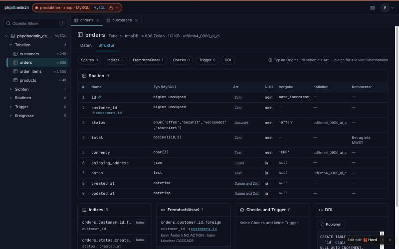
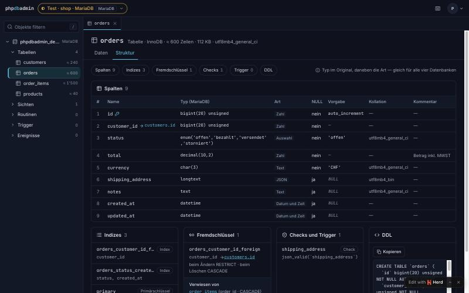
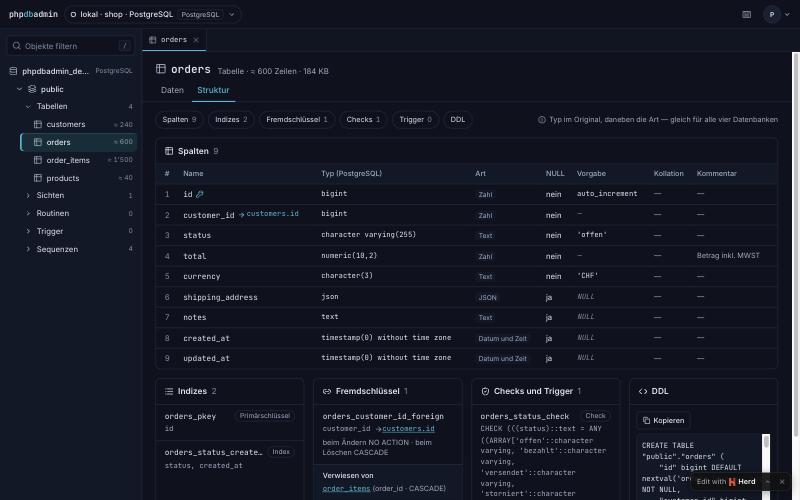
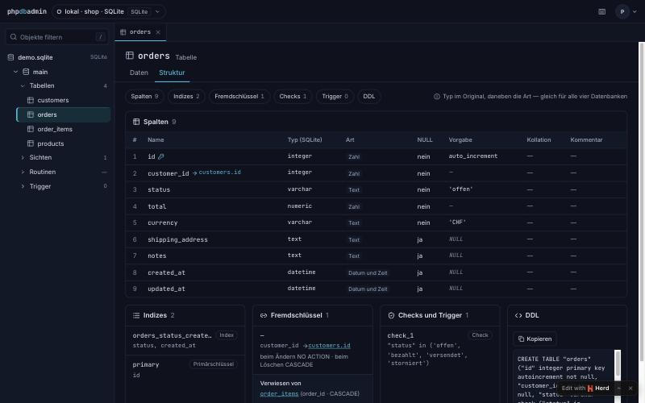

# Timebox 01 — Katalog und Navigator

**Stand:** 29.10.2026 · ✅ abgeschlossen bis auf V-06 (Favoriten, «zuletzt geöffnet»), das mit TB 07 im selben Zweig gebaut wird, weil beides an `connection_user` hängt. Gestartet auf Hoangs «nächste tb»; ab dem Abend auf seinen Auftrag «mache alle TB durch» ohne Rückfragen weitergeführt.

## Ziel

Eine Verbindung öffnen und darin arbeiten können: Arbeitsbildschirm mit Navigator für alle vier Datenbanken, Struktur einer Tabelle in denselben Begriffen, Schreibschutz und Umgebung sichtbar, Konten mit zu vielen Rechten gewarnt — auf Deutsch und Englisch.

## Umfang

| Scheibe | Anforderungen | Ergebnis |
|---|---|---|
| 1 Arbeitsbildschirm öffnen | V-04, V-10 | ✅ Kopf mit Umgebung (Farbe, Zeichen, Wort), roter Streifen bei Produktion, Titel «PROD · …», Kontowarnung; Passwort je Sitzung, Fehlerkarte statt Fehlerseite |
| 2 Navigator | O-01 | ✅ Datenbank → Schema → Gruppen (Tabellen, Sichten, Routinen, Trigger, Ereignisse, Sequenzen) mit Filter «/»; 1'000 Tabellen in einem Test |
| Zusatz «Alle Datenbanken anzeigen» | V-01 | ✅ Wunsch Hoang; Fehler aus seinem Durchlauf (Endlosschleife) behoben |
| 3 Strukturansicht | S-01, O-04 | ✅ Wireframe 08 bei 1440 und 375 px |
| 4 Favoriten, zuletzt geöffnet | V-06 | ⏳ im Zweig von TB 07 |
| 5 Deutsch und Englisch | N-06, O-06 | ✅ alle Texte über das Sprachsystem, Test über alle Schlüssel |
| 6 Abnahme | N-04, O-04 | ✅ O-04 Bildschirmfotos; N-04 Untergrenzen in der Wochen-Matrix (noch nie gelaufen, kein Remote) |

Wireframe-Bereiche 3 (Verbindungen), 5 (Arbeitsbildschirm), 8 (Struktur).

## Was entstanden ist

**Arbeitsbildschirm** (`/c/{verbindung}`, `/c/{verbindung}/s/{schema}`). `TargetConnections` öffnet Zielverbindungen je Anfrage mit Zeitlimit (15 s) und Schreibschutz, wenn die Verbindung schreibgeschützt ist; jede lesende Anweisung läuft zusätzlich im Wächter des Dialekts. Fehler der Zielverbindung werden zur Fehlerkarte mit Ursache und nächstem Schritt, fehlende Passwörter («nicht speichern») fragt eine eigene Seite einmal je Sitzung ab. Fehler der eigenen App-Datenbank bleiben Fehler der App (früher als «Verbindung gescheitert» getarnt — im Durchlauf von TB 02 gefunden).

**Alle Datenbanken (Wunsch Hoang).** Ohne Datenbanknamen zeigt MySQL/MariaDB alle Datenbanken als Schemas, PostgreSQL öffnet `postgres` und bietet die übrigen Datenbanken im Navigator an (`?db=`). Der Fehler aus Hoangs Durchlauf («Maximum call stack size … Infinite recursion») lag in Laravels `DatabaseManager`: zwei Zielverbindungen mit gleichem Namen trennten sich gegenseitig, der Neuaufbau traf das falsche Objekt. Zielverbindungen stehen seither in keinem globalen Register; der Neuverbinder erneuert genau dieses Objekt und richtet Schreibschutz, Authorizer und Zeitlimit wieder ein. Gegenprobe: Auf dem alten Stand hängen die neuen Tests in der Schleife.

**Struktur** (`…/o/{objekt}/structure`). `Structure` liest Spalten mit Typ im Original und einer **Art**, die in allen vier Datenbanken gleich heisst (`ColumnKind`: Zahl, Text, Auswahl, Wahrheitswert, Datum und Zeit, JSON, Binär, Kennung, Geometrie, Liste, Sonstiges), Indizes, Fremdschlüssel in beide Richtungen, Checks, Trigger und DDL. Gleichmacher für O-04: MariaDB-JSON (Alias für `longtext` mit `json_valid`) gilt als JSON, eigene Aufzählungstypen in PostgreSQL als Auswahl, Vorgaben als SQL-Literal (`'offen'` statt `offen` bzw. `'offen'::character varying`), MariaDBs Text «NULL» als keine Vorgabe.

**Deutsch und Englisch (N-06, O-06).** Der deutsche Text ist der Schlüssel im Code (`__('…')`, `t('…')`, `tc('…')`), `lang/en.json` liefert Englisch (britisch). Sprache aus dem Konto, sonst aus dem Browser, sonst Deutsch; Mails in der Sprache des Kontos. Die Oberfläche bekommt die Übersetzungen einmal je Sprache (Once-Prop). Sprachwahl im Konto unter «Darstellung». Alle bestehenden Seiten hat ein Helfer in einer eigenen Arbeitskopie umgestellt (Zweig zusammengeführt, 322 Zeilen ohne Abweichung).

## Abnahmekriterien

| Anforderung | Kriterium (CR-001) | Nachweis |
|---|---|---|
| V-04 | schreibgeschützte Verbindung lehnt jede schreibende Anweisung ab, auch Ausbruchsversuche | `DialectContractTest` (Wächter je Treiber), `TargetConnectionsTest` 19 Tests: Schreibschutz übersteht einen Neuaufbau (Laravel verbindet bei SQLSTATE 25006 neu) |
| V-10 | Herd-`root` warnt, Lesekonto nicht | `DialectContractTest` gegen root und `phpdbadmin_lesen` auf MySQL, MariaDB, PostgreSQL |
| O-01 | 1'000 Tabellen flüssig | `WorkspaceControllerTest::test_navigator_with_a_thousand_tables_stays_fast` (unter 1 s inkl. Seite) |
| O-04 | dieselbe Tabelle in allen vier Datenbanken | Bildschirmfotos unten; `StructureTest` 17 Tests (Art, Vorgaben, Fremdschlüssel beidseitig je Treiber) |
| S-01 | Beispieltabelle mit allen Merkmalen je Treiber | `StructureTest` (Kommentar, Aufzählung, JSON, Standardwerte, eindeutiger Index, Check, Trigger, Sicht), `ObjectControllerTest` |
| N-06 / O-06 | Sprachdateien vollständig ohne Rückfall | `LanguageFilesTest` (5): jeder Schlüssel mit englischer Zeile, keine verwaisten, gleiche Platzhalter, keine dynamischen Schlüssel, Feldnamen beider Sprachen; `LocaleControllerTest` (5) |
| N-04 | Untergrenzen | Wochen-Matrix «untergrenzen» (MariaDB 10.6, MySQL 8.0, PostgreSQL 14) — **noch nie gelaufen** (kein Remote); lokal nur aktuelle Versionen |

### O-04: dieselbe Tabelle `orders` in allen vier Datenbanken

| MySQL 8.4 (Produktion, schreibgeschützt) | MariaDB 10.11 (Test) |
|---|---|
|  |  |
| **PostgreSQL 18 (lokal)** | **SQLite (lokal)** |
|  |  |

Gleich: Aufbau, Begriffe, Art je Spalte, Vorgaben als Literal, Fremdschlüssel beidseitig. Erklärte Unterschiede: PostgreSQL legt Laravels `enum()` als `varchar` mit Check an (Art «Text», der Check steht daneben), SQLite kennt weder Zeilenschätzung noch Kollation noch Namen für Fremdschlüssel.

## Abweichungen von den Wireframes

| Bereich | Abweichung | Grund |
|---|---|---|
| 08 Kopf | Grösse als eine Zahl statt «Daten · Indizes» | Laravel liefert die Gesamtgrösse; getrennte Werte bräuchten je Treiber eigene Abfragen — später, falls gewünscht |
| 08 Knöpfe | «Tabelle ändern», «Exportieren», «Im Editor öffnen» fehlen | kommen mit TB 05, TB 06, TB 03 |
| 08 Reiter | «Beziehungen» und «SQL» fehlen | Beziehungsdiagramm S-07 (TB 10), SQL-Editor (TB 03) |
| 05 Kopf | Suchfeld ⌘K fehlt | Befehlspalette O-02 (TB 03) |

## Tests

Neu oder erweitert: `StructureTest` (17), `ColumnKindTest` (25), `ObjectControllerTest` (Struktur-Teil), `TargetConnectionsTest` (+3, unabhängige Verbindungen, Schlüssel je Datenbank), `WorkspaceControllerTest` (+1, Ablauf aus Hoangs Durchlauf), `DialectContractTest` (+1, VACUUM trotz ATTACH-Wächter), `LanguageFilesTest` (5), `LocaleControllerTest` (5) und die Englisch-Tests des Übersetzungs-Helfers. Zielserver-Tests laufen über `PHPDBADMIN_TEST_DATABASE` auch parallel in mehreren Arbeitskopien.

## Commits

`d4766fa` Scheiben 1+2 · `0842694` Dialekt · `777ce66` alle Datenbanken · `a35ad37` Endlosschleife · `3dd2e9b` Struktur lesen · `884bf8e` Testdatenbank einstellbar · `dcf9e21` Sprachgrundlage · `6db5d35` Strukturansicht · `6a72d92` · `d2227f5` VACUUM · `558b4ae` Vorgaben, Chip · `c503ced`–`7f4c944` Sprache (Helfer) · `80fed1d` Merge · `8069824` Untergrenzen · `1c8f969` MariaDB-Vorgabe.

## Gelernt

- Laravels `DB::build()` mit gleichem Namen ersetzt die vorhandene Verbindung; `DB::reconnect()` erneuert das Objekt im Register, nicht das in der Hand. Zielverbindungen deshalb ausserhalb des Registers bauen (Lektion im Vault).
- «Connection refused» hält Laravel für eine verlorene Verbindung und versucht neu — ohne Neuverbinder ein `LostConnectionException`. Sofort verbinden, dann kommt der Fehler als PDO-Fehler.
- Ein leeres PHP-Array wird zu JSON `[]`, und `[].sort` ist in JavaScript eine Methode: Zuordnungen an die Oberfläche als Objekt senden.
- Symfony schickt in Tests `Accept-Language: en-us` mit — mit Sprachwahl aus dem Browser kippen sonst alle deutschen Erwartungen.
