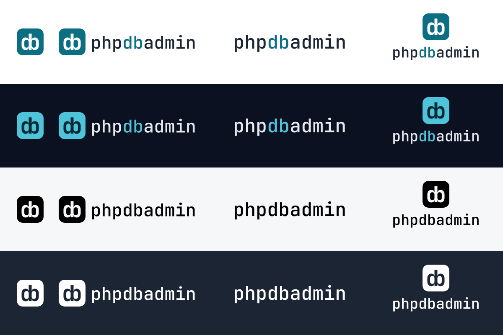

# Logo-Kit phpdbadmin

Stand 29.10.2026 · Entscheid G-06 in [`gestaltung.md`](../../dokumentationen/03-foundation/gestaltung.md). Alles hier
entsteht aus `quellen/glyphen.json` mit `python3 resources/brand/quellen/bauen.py` — Dateien nicht von Hand ändern.

## Teile

| Teil               | Datei                | Wofür                                                                                                       |
| ------------------ | -------------------- | ----------------------------------------------------------------------------------------------------------- |
| **Bildmarke**      | `zeichen.svg`        | Die «db»-Ligatur mit gemeinsamem Stamm auf Petrol. Favicon, App-Symbol, Avatar, überall wo wenig Platz ist. |
| **Schriftzug**     | `schriftzug.svg`     | «phpdbadmin» in JetBrains Mono SemiBold, «db» im Akzent — als Pfade, braucht keine Schrift.                 |
| **Logo quer**      | `logo.svg`           | Bildmarke und Schriftzug nebeneinander. Standard für Kopfzeilen, Mails, Dokumente.                          |
| **Logo gestapelt** | `logo-gestapelt.svg` | Bildmarke über dem Schriftzug. Für quadratische Flächen, Titelseiten, Präsentationen.                       |
| **Glyphe**         | `glyphe.svg`         | Nur die Ligatur in `currentColor`, ohne Fläche — für Inline-Gebrauch in Text und Knöpfen.                   |

Jeder Teil gibt es in vier Fassungen:

| Endung     | Fläche der Marke      | Ligatur     | Schrift                         | Grund                                    |
| ---------- | --------------------- | ----------- | ------------------------------- | ---------------------------------------- |
| _(keine)_  | Petrol `#0b6e82`      | Weiss       | Schiefer `#1c2534`, «db» Petrol | hell                                     |
| `-dunkel`  | Petrol hell `#4fc3d9` | `#062a33`   | `#e5e9f0`, «db» `#4fc3d9`       | dunkel                                   |
| `-schwarz` | Schwarz               | ausgestanzt | Schwarz                         | hell, einfarbig (Druck, Stempel, Gravur) |
| `-weiss`   | Weiss                 | ausgestanzt | Weiss                           | dunkel oder auf Fotos, einfarbig         |

Die Farben sind die Akzent- und Textfarben aus `gestaltung.md` § 2 — dieselben, die die Oberfläche hell und dunkel
benutzt. In der App zeichnet `resources/js/components/Wordmark.vue` das Logo mit den Variablen `--primary` und
`--primary-foreground`, damit es dem Farbschema folgt.

## Regeln

- **Schutzraum:** rund um das Logo frei mindestens ein Viertel der Kantenlänge der Bildmarke (bei 32 px also 8 px).
- **Mindestgrösse:** Bildmarke 16 px (dafür das Favicon mit grösserer Ligatur), Logo quer 120 px breit, Schriftzug
  allein 96 px breit.
- **Nicht:** Ligatur ohne Fläche in Petrol auf Petrol, Schriftzug in einer anderen Schrift setzen, «db» anders als im
  Akzent einfärben (ausser einfarbig), Teile verzerren, drehen, mit Schatten oder Verlauf versehen, die Marke in
  andere Formen als das abgerundete Quadrat setzen.
- **Gefahr-Rot** ist für Gefahr reserviert (`gestaltung.md` § 1) und nie eine Logofarbe.

## Dateien

| Ordner     | Inhalt                                                                                                                                                                                                                                       |
| ---------- | -------------------------------------------------------------------------------------------------------------------------------------------------------------------------------------------------------------------------------------------- |
| `*.svg`    | Vektordateien aller Teile und Fassungen, dazu `favicon.svg`                                                                                                                                                                                  |
| `png/`     | Rasterexporte: Bildmarke 64/256/1024 px, Logos und Schriftzüge 96 und 384 px hoch, `favicon-16…512.png`, `favicon.ico` (16/32/48), `apple-touch-icon.png` (180, randlos — iOS rundet selbst), `og-bild.png` (1200 × 630 für Link-Vorschauen) |
| `mail/`    | `logo@2x.png` — in Mails eingebettet (Content-ID), angezeigt 163 × 32 px                                                                                                                                                                     |
| `quellen/` | `glyphen.json` (Umrisse aus JetBrains Mono), `glyphen.swift` (holt sie mit CoreText), `bauen.py` (baut alles)                                                                                                                                |

`bauen.py` kopiert `favicon.svg`, `favicon.ico` und `apple-touch-icon.png` nach `public/` und schreibt die Pfade der
Bildmarke nach `resources/js/lib/brand.ts`. Es braucht `rsvg-convert` (Homebrew `librsvg`) und Pillow.

Browser halten Favicons lange fest. Die App (`resources/views/app.blade.php`) und die Website (`website/bauen.py`)
hängen deshalb die Prüfsumme der Datei an die Adresse (`/favicon.svg?v=…`) — ein neues Symbol erscheint sofort. Der
Web-Installer trägt `favicon.svg` eingebettet (`data:`-Adresse), weil neben ihm noch keine Datei liegt: nach einer
Änderung dort neu einsetzen; `WebInstallerTest` und `StarterKitRemovalTest` vergleichen beides mit diesem Kit.

## Schrift und Lizenz

Bildmarke und Schriftzug sind aus [JetBrains Mono](https://www.jetbrains.com/lp/mono/) 2.304 gezeichnet (Ligatur aus
Bold, Schriftzug aus SemiBold) und als Pfade abgelegt. JetBrains Mono steht unter der SIL Open Font License 1.1; die
OFL erlaubt Logos und Grafiken aus der Schrift. Das Logo selbst gehört zu phpdbadmin (MIT-Lizenz des Projekts).
